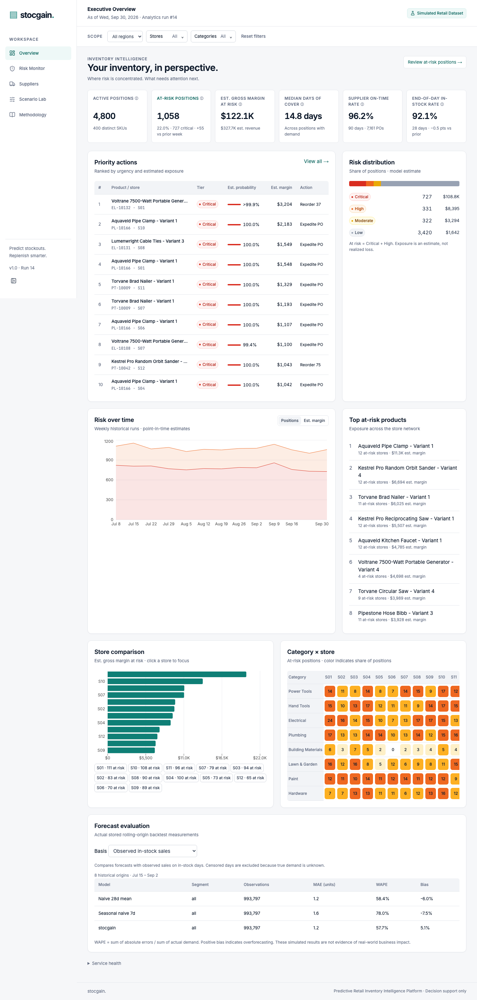
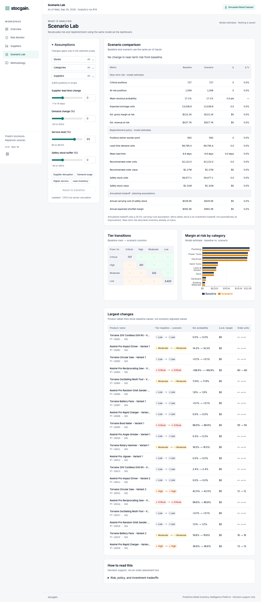
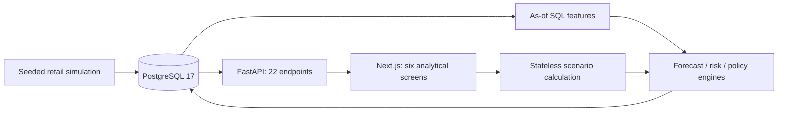

# stocgain.

**Predictive Retail Inventory Intelligence Platform**

*Predict stockouts. Replenish smarter.*

The name combines “Stock Again” and “Stock + Gain”.

Inventory intelligence for a fictional home-improvement retailer. **Simulated Retail Dataset**: no real retailer data or affiliation.

**Stages 1–2 and the Stage 3 application are implemented.** PostgreSQL holds the deterministic retail dataset and verified analytics runs. The frontend provides Executive Overview, Inventory Risk Monitor, product detail, supplier performance, Scenario Lab and Methodology, backed by all 22 specified APIs. Warm Scenario Lab browser p95 is 1.383 s over 20 full-scope evaluations; cold first load is 7.014 s. See [implementation status](IMPLEMENTATION_STATUS.md) for final verification and outstanding fresh-setup acceptance. No public deployment is included.

## Prerequisites

- Python 3.12 and uv (lockfile created with uv 0.13.0)
- Node 22 (`nvm use`; `.nvmrc` selects the supported major) and npm
- Docker Desktop with Compose v2 or later, installed and running

## Local setup

Run from the repository root:

```bash
make setup                       # root .env, locked Python + npm dependencies
make db-up                       # PostgreSQL 17, localhost:5433, test database too
make migrate                     # four revisions, then delivered views
make seed PRESET=standard SEED=42 # deterministic data, safe load and validation
make analytics                   # historical backfills + current model/evaluation
make api                         # terminal 1: http://localhost:8000/docs
make web                         # terminal 2: http://localhost:3050
```

For this already-populated checkout, only `make db-up`, `make api` and `make web` are needed; do not reseed or rerun analytics just to launch the UI. Every business metric comes from the actual API. Cold projection/scenario requests may take several seconds to warm the model cache. Global filters persist in the URL; scenarios are stateless and never create purchase orders. The Overview service-health panel reports actual API/database readiness.

`.env.example` contains local-only example credentials. `make setup` preserves an existing `.env`; the backend and Next config load it from the repository root. Adjust both connection URLs if changing the database port or credentials. Never commit `.env`. `DATABASE_URL_PSQL` is the libpq form for future SQL tools. Only localhost ports are published by Compose.

Optional container configuration: `docker compose --profile full up --build`. The full profile has not been verified. Browser API URL is baked into the frontend image via the build argument; rebuild the image after changing it.

## Verification

```bash
make lint
make typecheck
make test                        # includes real PostgreSQL test; fails if DB unavailable
make openapi                     # API schema and generated TypeScript
make check-openapi
make verify                      # lint + types + tests + schema drift
cd frontend && npx playwright install chromium
cd .. && make e2e                # requires running API + web + PostgreSQL
```

DB-independent checks during setup troubleshooting:

```bash
uv run --project backend --locked pytest backend/tests/unit -q
make test-frontend
cd frontend && npm run build
```

Do not substitute these unit checks for the phase's PostgreSQL acceptance gate.

## Structure and next work

- `backend/src/stocgain/`: forecasting and risk engines, SQL-backed API services, scenarios, CLI and PostgreSQL integration.
- `backend/migrations/`: four reversible Alembic revisions for the 26 specified physical tables.
- `frontend/`: Next App Router analytics application, shared design tokens and components, generated API types, Vitest/Playwright tests.
- `sql/`: Phase 1 reconciliation, 18 quality checks, calibration SQL and schema dump; Phase 2 SQL and EXPLAIN wrappers are implemented.
- `docs/00`–`docs/11`: authoritative product and engineering specifications.
- `IMPLEMENTATION_CONTRACT.md`: compact compatibility contract and planned data interfaces.

`make seed` revalidates identical content without replacement and refuses to overwrite a different dataset. To intentionally replace application rows, use `LOAD_FLAGS=--replace` only after reviewing the destination and backing it up; this also clears analytics outputs. Databases and volumes are retained. `make pipeline` runs migrate, safe seed and analytics in order. `make db-reset`, `dev` and `demo-docker` remain unimplemented. `make analytics` is implemented and preserves operational data. `make schema-dump` writes actual DDL to `sql/schema/current.sql`.

Standard verification after seeding:
```bash
uv run --project backend --locked stocgain data profile
uv run --project backend --locked pytest backend/tests/db/test_standard_dataset.py -m slow -q
```

Default tests seed the existing test database with the small preset; they refuse a different existing dataset. The explicit slow acceptance test reads the standard dataset in the main database. See [Phase 1 evidence](docs/PHASE1_VERIFICATION.md) for actual counts and timings.

SQL commands (existing populated database):
```bash
uv run --project backend --locked stocgain db run-analysis 06
uv run --project backend --locked stocgain db refresh
make explain                     # standard dataset; saves actual plans and timings
```

The MV refresh is batch-only and non-concurrent; independent operational changes require an explicit refresh. Reapplying views recreates/populates it. See [Stage 1 verification](docs/PHASE2_VERIFICATION.md) and [performance results](docs/perf/QUERY_PERFORMANCE.md). No model outputs are fabricated for SQL demonstrations.

## Known limitations

Docker Desktop and PostgreSQL 17.11 are working locally. Phase 0's real database test and full-stack browser test passed. Four schema revisions passed an empty-test-database downgrade/re-upgrade round trip, and were applied to the existing project database. The standard dataset is loaded and reconciles. Phase 2 SQL and historical extraction isolation are verified. Model-output comparison tests now execute; Stage 2 measurements are recorded in docs/PHASE4_VERIFICATION.md. Optional large generation and full Compose image builds are unverified. Two on-time calibration deviations are documented in the decisions log.

npm reports five high-severity development-only advisory entries rooted in `braces` through the Next ESLint plugin; latest available braces 3.0.3 is affected. ESLint 9 is deprecated upstream but currently required by the selected React/import lint plugins. No forced incompatible downgrade or hidden warning suppression was applied. Track these in `docs/DECISIONS_LOG.md`.

The MIT copyright holder remains `<Project Owner>` as required by the Phase 0 specification; replace with the owner's preferred legal name before publishing.

Setup references used: [Next.js installation](https://nextjs.org/docs/app/getting-started/installation), [shadcn manual installation](https://ui.shadcn.com/docs/installation/manual), [uv locking and syncing](https://docs.astral.sh/uv/concepts/projects/sync/).

## Portfolio walkthrough





[Two-minute demo and resume drafts](docs/INTERVIEW_DEMO.md) · [Forecast findings](docs/FORECAST_FINDINGS.md) · [Publication/deployment handoff](docs/PUBLICATION_AND_DEPLOYMENT.md) · [Third-party notices](THIRD_PARTY_NOTICES.md)



The [26-table ERD](docs/03_DATABASE_DESIGN.md) and architecture specifications document the data relationships. SQL examples worth reviewing: availability classification in `sql/views/020_mv_daily_position.sql`, stockout gaps-and-islands in `sql/views/090_v_stockout_episodes.sql`, and receipt-cutoff-safe outstanding quantities in `sql/pipeline/extract_open_po_lines.sql`.

The model excludes stockout-censored observations, uses recent-weighted demand and documented sparse-history fallbacks, and evaluates risk at receipt checkpoints. Safety stock is a policy decision; changing its service target does not change stock already on hand. All exposure is estimated, not realized financial loss.

Observed-data WAPE is **57.66% versus 58.39%** for a 28-day naive average: **0.73 percentage points**, approximately **1.25% relative**. This is a limited improvement on synthetic backtests; erratic demand is worse than naive. Do not interpret it as proven real-retailer impact. Future work should validate a challenger on the same historical origins, improve uncertainty calibration, and complete isolated deployment verification before hosting.
