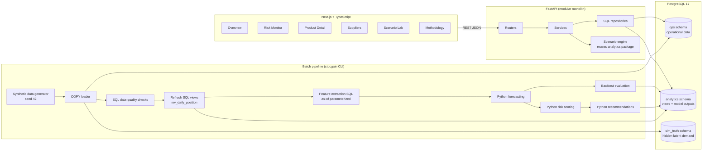

# stocgain. — Design Summary and Decision Register

> **Predict stockouts. Replenish smarter.**
>
> **Predictive Retail Inventory Intelligence Platform.** The name combines “Stock Again” and “Stock + Gain”.
>
> stocgain is an independent portfolio project. It is not affiliated with, endorsed by, or built from data belonging to The Home Depot, Lowe's, Walmart, Target, or any other company. All data is synthetic and labeled as such.

This document is the entry point to the design package. It summarizes the product, records every major decision in one place, defines the **canonical constants** that all other documents must agree with, and records the results of the final design self-review.

If any document conflicts with the **Canonical Constants** table in §4, this document wins, and the conflict is a bug to be fixed.

---

## 1. Document map

| # | File | What it answers |
|---|------|-----------------|
| 00 | `docs/00_DESIGN_SUMMARY.md` | What are the decisions, constants, and review results? |
| 01 | `docs/01_PRODUCT_REQUIREMENTS.md` | Who is this for, what problems, which features, what counts as success? |
| 02 | `docs/02_TECHNICAL_ARCHITECTURE.md` | What stack, which modules, how data flows, and why (ADRs)? |
| 03 | `docs/03_DATABASE_DESIGN.md` | Exactly which tables, columns, constraints, indexes, views? |
| 04 | `docs/04_SQL_ANALYTICS.md` | Which SQL analyses, views, and KPIs, and how are they optimized? |
| 05 | `docs/05_ANALYTICS_MODELS.md` | Exactly how forecasting, risk, replenishment, exposure, and scenarios are calculated? |
| 06 | `docs/06_DATA_GENERATION.md` | How is the synthetic retail network simulated, deterministically? |
| 07 | `docs/07_UI_UX_SPECIFICATION.md` | What does every page look like and do? Which design tokens? |
| 08 | `docs/08_API_SPECIFICATION.md` | Which endpoints, with which request/response contracts? |
| 09 | `docs/09_IMPLEMENTATION_ROADMAP.md` | In what order does Codex build it, and how is each phase verified? |
| 10 | `docs/10_TEST_AND_QA_PLAN.md` | How is correctness proven? |
| 11 | `docs/11_PORTFOLIO_AND_DEMO.md` | How is the project presented, demonstrated, and described on a resume? |
| — | `CODEX_HANDOFF.md` | Consolidated implementation contract for Codex. |
| — | `AGENTS.md` | Standing instructions for the coding agent. |

Reading order for Codex: `AGENTS.md` → `CODEX_HANDOFF.md` → this file → the numbered docs relevant to the current phase.

---

## 2. Product in one paragraph

stocgain is a lightweight internal analytics web application for a fictional 12-store home-improvement retailer. It loads 180 days of simulated store-SKU-day operations (sales, inventory balances, purchase orders, receipts, adjustments, promotions) into PostgreSQL; uses SQL views and analytical queries to build operational features (sales velocity, availability, supplier lead-time performance, stockout history); uses Python to estimate stockout-censored demand, lead-time demand distributions, safety stock, reorder points, and the probability of stocking out before replenishment arrives; converts those into prioritized, explained replenishment recommendations with model-based financial exposure; and serves everything through a FastAPI REST API to a polished Next.js dashboard with an interactive Scenario Lab.

---

## 3. Decision summary (the twenty decisions that shape everything)

| # | Decision | Choice | Primary rationale |
|---|----------|--------|-------------------|
| D1 | Architecture style | **Modular monolith**: one FastAPI backend package + one Next.js frontend + PostgreSQL | Simplest system that supports every feature; easy to explain. |
| D2 | Database | **PostgreSQL 17** with three schemas: `ops`, `analytics`, `sim_truth` | Window functions, materialized views, `percentile_cont`, `FILTER`, BRIN; schemas make provenance explicit. |
| D3 | Where analytics live | **SQL** for joins, aggregations, status derivation, supplier stats, KPI rollups; **Python** for forecasting, probability distributions, recommendations, backtesting, scenarios | Each language does what it is best at; SQL work is visible in `sql/`. |
| D4 | Analytics refresh | **Explicit batch command** (`make analytics`) writing versioned results to `analytics.*` tables tagged by `run_id`; API reads the latest successful run | No recalculation per request; full lineage; reproducible. |
| D5 | Time model | Fixed simulated calendar **2026-04-04 → 2026-09-30**; **as-of date = 2026-09-30** (end of day); forecasts cover **2026-10-01 onward** | Reproducible regardless of the real-world date. |
| D6 | Grain | **Store × SKU × day**, dense (one row per combination per day, zeros included) | Zero is information; dense grain simplifies window functions and matrix math. |
| D7 | Replenishment network | **Direct-to-store** supplier deliveries via weekly-review purchase orders per supplier→store **lane**; no distribution centers | Keeps the model explainable; documented limitation. |
| D8 | Demand forecast | **Censoring-aware, exponentially weighted level** (56-day lookback, 14-day half-life) × **category day-of-week index** × **planned promotion lift**, with blended/chain fallbacks for sparse data | Transparent, defensible, testable; handles stockout-censored sales. |
| D9 | Censored demand | Days where the item **sold out** or was **out all day** are **excluded** from level and variance estimation (treated as missing, not zero) | Prevents the classic "stockouts look like low demand" death spiral. |
| D10 | Lead time | Estimated per **supplier→store lane** from received POs as of the run date; fallback to supplier level, then contract lead time | Lane-level reflects regional differences; fallbacks handle sparse lanes. |
| D11 | Demand-over-window distribution | Mean/variance from the standard **lead-time demand formula**; **Normal** if mean ≥ 20 units, else **Negative Binomial** (variance > mean) or **Poisson** | Normal is explainable for fast movers; count distributions are correct for slow movers. |
| D12 | Safety stock / reorder point | **Reorder point = service-level quantile of lead-time demand**; safety stock = reorder point − expected lead-time demand; Normal case reduces to `z·σ` | One formula that is correct for both fast and slow movers. Default cycle service level **95%**. |
| D13 | Stockout probability | Probability that demand exceeds supply at **checkpoints**: just before each open PO arrives within the **protection window**, and at the window end (= the lane's mean lead time, i.e., when an order placed now would arrive). Risk = **maximum** checkpoint probability | Correctly incorporates incoming POs without double counting; explainable as "we check stock just before each delivery." |
| D14 | Risk tiers | Driven by stockout probability (≥50% Critical, ≥25% High, ≥10% Moderate), "currently out of stock" → Critical, and one-tier **financial escalation** (Moderate → High when margin at risk ≥ $250) | Probability and dollars, no arbitrary weighted score. |
| D15 | Financial exposure | **Expected shortage units × category lost-sale rate × unit price (revenue) or unit margin (gross margin)**; labeled as model estimates | Doesn't assume all unmet demand is lost; doesn't double-count probability. |
| D16 | Recommendations (MVP) | `expedite_po`, `reorder`, `monitor`, `no_action` per position; supplier-level "Review supplier" flag; transfers are **P2** | Deterministic rules; realistic actions; no automatic ordering. |
| D17 | Prioritization | Lexicographic: **risk tier → margin at risk → soonest projected stockout → stable ID tiebreak** | Easy to explain; no invented weights. |
| D18 | Scenario Lab | Stateless `POST /api/v1/scenarios/evaluate` re-running the **same Python functions** used by the pipeline on cached baseline inputs; neutral assumptions must reproduce the stored baseline exactly | No fake results; strong correctness test. Persistent scenario history is **P2**. |
| D19 | Synthetic data | Deterministic causal simulation (seed **42**) with a deliberately **naive legacy replenishment policy**, latent demand stored only in `sim_truth` | Realistic stockouts and censoring; honest provenance; hidden truth enables a clearly labeled simulation-only evaluation. |
| D20 | Frontend data access | Client components with **TanStack Query** against the FastAPI API; TypeScript types **generated from the OpenAPI schema** | Explicit loading/error states; no drift between backend and frontend types. |

---

## 4. Canonical constants

Every document, config file, and test must use these values. Values marked *config* live in `backend/config/analytics.toml` or `backend/config/generator.toml` and are persisted per analytics run in `analytics.analytics_runs.config`.

### 4.1 Calendar and scale

| Constant | Value |
|----------|-------|
| History start (standard preset) | 2026-04-04 (Saturday) |
| History end / default as-of date | 2026-09-30 (Wednesday), end of day |
| History length (standard) | 180 days |
| Forecast days stored | 42 (2026-10-01 → 2026-11-11 for the current run) |
| Display horizons | 7, 14, 28 days |
| Generator burn-in (simulated, discarded except POs) | 35 days |
| Default seed | 42 |
| Presets | `small`: 3 stores, 60 SKUs, 10 suppliers, 120 days (2026-06-03 → 2026-09-30) · `standard`: 12 stores, 400 SKUs, 48 suppliers, 180 days · `large`: 30 stores, 1,000 SKUs, 100 suppliers, 365 days (2025-10-01 → 2026-09-30) |
| Store-SKU-day rows | small 21,600 · standard 864,000 · large 10,950,000 |
| Regions (standard) | Southeast, Northeast, Midwest, Southwest (3 stores each) |
| Categories (standard SKU counts) | Power Tools 45, Hand Tools 50, Electrical 60, Plumbing 55, Building Materials 45, Lawn & Garden 55, Paint 40, Hardware 50 (= 400) |
| Suppliers (standard) | 48 = 6 per category |
| Supplier→store lanes (standard) | 576 |
| US holidays in window | Memorial Day 2026-05-25, Independence Day 2026-07-04, Labor Day 2026-09-07 |

### 4.2 Analytics parameters (*config*, `analytics.toml`)

| Parameter | Value | Meaning |
|-----------|-------|---------|
| `model_version` | `stocgain-baseline-1.0` | Stamped on every run |
| `lookback_days` | 56 | Forecast history window |
| `half_life_days` | 14 | EWMA weight half-life |
| `min_clean_days_full` | 14 | Clean days needed for a pure store-SKU estimate |
| `min_clean_days_blend` | 7 | Below this, chain fallback only |
| `forecast_horizon_days` | 42 | Daily forecasts stored |
| `service_level` | 0.95 | Cycle service level (probability of no stockout per replenishment cycle) |
| `review_period_days` | 7 | Weekly ordering cadence |
| `normal_min_mean_units` | 20 | Use Normal distribution at/above this window mean |
| `tier_critical_probability` | 0.50 | |
| `tier_high_probability` | 0.25 | |
| `tier_moderate_probability` | 0.10 | |
| `exposure_escalation_usd` | 250.00 | Moderate → High when margin at risk ≥ this |
| `expedite_probability` | 0.25 | Min probability for `expedite_po` on a receipt checkpoint |
| `lane_min_observations` | 8 | Received POs needed for lane-level lead-time stats |
| `contract_lead_time_cv` | 0.25 | Fallback σ = 0.25 × contract lead time |
| `default_delay_when_late_days` | 3 | Fallback lateness for overdue POs |
| `carrying_cost_rate_annual` | 0.25 | Assumption for Scenario Lab tradeoffs |
| `backfill_weeks` | 12 | Weekly historical runs (13 runs including current) |
| `backtest_origins` | 8 | Weekly rolling origins; last origin = as-of − 28 days |
| `on_time_window_days` | 90 | Supplier on-time KPI window |
| Lost-sale rates by category | Power Tools 0.50, Hand Tools 0.40, Electrical 0.55, Plumbing 0.65, Building Materials 0.70, Lawn & Garden 0.60, Paint 0.45, Hardware 0.35 | Share of expected shortage assumed lost (not substituted or deferred) |

### 4.3 Enumerations (lowercase snake_case in DB and API; Title Case in UI)

| Enum | Values |
|------|--------|
| `availability_status` | `in_stock`, `sold_out`, `out_all_day` |
| `risk_tier` | `critical`, `high`, `moderate`, `low` |
| `action_type` | `expedite_po`, `reorder`, `monitor`, `no_action` |
| `forecast_method` | `store_sku`, `blended`, `chain_fallback`, `insufficient_data` |
| `demand_pattern` | `smooth`, `erratic`, `intermittent`, `lumpy`, `no_demand` |
| `distribution_family` | `normal`, `negative_binomial`, `poisson`, `degenerate` |
| `checkpoint_type` | `receipt`, `window_end` |
| `lead_time_source` | `lane`, `supplier`, `contract` |
| `run_type` | `current`, `backfill` |
| `run_status` | `running`, `succeeded`, `failed` |
| `adjustment_reason` | `shrink`, `damage`, `cycle_count_correction`, `vendor_return` |
| `risk_driver` | `currently_out_of_stock`, `coverage_gap`, `no_inbound_supply`, `overdue_po`, `supplier_unreliable`, `lead_time_variability`, `demand_acceleration`, `high_demand_variability`, `recent_stockouts`, `upcoming_promotion`, `limited_history` |

### 4.4 Local environment

| Item | Value |
|------|-------|
| PostgreSQL | 17, container port 5432, host port **5433** (avoids clashing with a Homebrew Postgres) |
| Database / user / password | `stocksense` / `stocksense` / `stocksense` (local only) |
| Test database | `stocksense_test` |
| API | FastAPI on **8000**, prefix **`/api/v1`** |
| Web | Next.js on **3000** |
| Python | 3.12 (≥ 3.11 supported), managed by **uv** |
| Node | 22 LTS |

### 4.5 Naming and unit conventions (API and DB)

- Ratios and probabilities are always on a **0–1 scale** and named `*_rate`, `*_probability`, or `service_level`. The UI formats them as percentages. No API field carries 0–100 percentages.
- Money fields end in `_usd` (API) and are `numeric(12,2)` in the database.
- Quantity fields end in `_units`; durations end in `_days`.
- Dates are ISO `YYYY-MM-DD`; timestamps are ISO 8601 UTC.

---

## 5. Architecture at a glance

---

## 6. Scope boundaries

**In scope (P0):** database, generator, SQL analyses and views, forecasting, risk scoring, basic recommendations, Overview, Risk Monitor, Product Detail, basic Scenario Lab, API, local setup, core tests, data labeling.

**P1:** supplier performance page, risk sensitivity panel, CSV export, forecast evaluation panel, methodology page polish, advanced filters, screenshots, README polish.

**P2 (only with explicit reason):** ML forecasting, store transfers, alternative suppliers, anomaly detection, alerts, persistent scenario history, authentication, hosted deployment, optimization.

**Explicit non-goals:** automatic purchase order placement, real retailer data, multi-tenant auth, microservices, streaming, Kubernetes, distribution-center modeling, price optimization.

---

## 7. Assumptions register

| ID | Assumption | Where it matters | Documented in |
|----|-----------|------------------|---------------|
| A1 | All 12 stores carry all 400 SKUs (full assortment) | Row counts, risk population | 06 |
| A2 | Suppliers ship directly to stores; no DC | Lead times, PO model | 06, 05 |
| A3 | No customer backorders or committed inventory; cash-and-carry retail | Inventory position = on hand + on order | 05 |
| A4 | Receipts arrive at start of day and are sellable that day; adjustments post at end of day | Inventory equation, availability status | 03, 06 |
| A5 | Daily demand values are independent across days, and independent of lead time | Lead-time demand variance formula | 05 |
| A6 | Prices are static except during promotions | Exposure uses regular price | 05 |
| A7 | Lost-sale rates by category are planning assumptions, not measured facts | Financial exposure | 05 |
| A8 | Planned promotion lift is known in advance (merchandising plan); realized lift differs | Forecast | 05, 06 |
| A9 | Orders may be placed off-cycle on the day after the as-of date | Protection window | 05 |
| A10 | Lead-time estimates use only POs received by the as-of date (right-censoring of very late POs is a known bias) | Lead-time stats | 05 |

---

## 8. Self-review results (Section 21 of the brief)

This review was performed after drafting all documents. Each question is answered with the resolution applied.

| # | Question | Result |
|---|----------|--------|
| 1 | Can Codex implement without inventing major requirements? | **Yes.** Every table, column, formula, endpoint, page, and acceptance criterion is specified. Low-level choices (component file splits, helper names) are intentionally left to Codex. |
| 2 | Is the PostgreSQL schema internally consistent? | **Yes.** 26 tables (17 `ops`, 8 `analytics`, 1 `sim_truth`) plus 12 views; all FKs reference existing PKs/unique keys; the inventory equation is enforced by a data-quality check rather than duplicated columns. `purchase_orders.status` was removed in favor of a derived view to prevent inconsistency. |
| 3 | Are analytics mathematically reasonable? | **Yes.** Standard lead-time demand formula, quantile-based safety stock, expected-shortage (loss function) for exposure, count distributions for slow movers. Approximations (checkpoint maximum as a lower bound on union probability; independence) are documented in 05 §8. |
| 4 | Can every KPI be traced? | **Yes.** 04 §6 and 03 §9 give lineage for each KPI from source table → SQL → Python → API field → UI element. |
| 5 | Are simulated and estimated values identified? | **Yes.** `sim_truth` schema is physically separate; UI shows a persistent "Simulated Retail Dataset" badge and "Model estimate" labels on every estimated value. |
| 6 | Does forecasting handle censored sales? | **Yes.** 05 §3. Censored days are excluded; fallback hierarchy for sparse clean data; worked example shows a 65% difference vs. naive. |
| 7 | Does risk handle incoming POs correctly? | **Yes.** 05 §5. Open quantity = ordered − received − cancelled; each PO counted once in cumulative supply at its expected arrival; overdue POs re-estimated; no double counting with inventory position. |
| 8 | Can a user understand why a recommendation was generated? | **Yes.** Every position stores driver codes, all inputs, and a deterministic explanation; detail page shows the full calculation. |
| 9 | Are API contracts complete for frontend? | **Yes.** 08 defines every endpoint each page uses (07 maps page → endpoint). |
| 10 | Does UI have decision value? | **Yes.** 07 lists the decision each element supports; decorative elements were removed (e.g., no donut charts, no generic "sales over time" hero chart). |
| 11 | Is visual direction specific? | **Yes.** Full token set, typography scale, chart rules, and wireframes. |
| 12 | Runs locally? | **Yes.** Docker Compose for Postgres (and optionally all services); documented `make` targets. |
| 13 | Can the student explain it? | **Yes.** 11 provides plain-language explanations and a Q&A bank. |
| 14 | Is scope realistic? | **Yes.** P0 is ~6 pages-equivalent of UI and a single analytics pipeline. Transfers, ML, and scenario persistence were moved to P2. |
| 15 | Are edge cases documented? | **Yes.** 05 §11 edge-case table; 10 test matrix. |
| 16 | Unnecessary dependencies avoided? | **Yes.** No Redis, Celery, Airflow, ORMs on the frontend, or chart libraries beyond Recharts. TOML config uses the standard library. |
| 17 | Verifiable completion criteria? | **Yes.** Each phase in 09 has commands and a Definition of Done. |
| 18 | Contradictions? | Resolved — see §9. |

---

## 9. Contradiction and ambiguity log (resolved)

| # | Conflict found during drafting | Resolution |
|---|-------------------------------|------------|
| C1 | Brief asks for "average inventory days of cover"; mean is dominated by slow movers with hundreds of days | KPI is **median days of cover** over positions with forecast demand > 0; labeled "Median" everywhere (01, 04, 07, 08). |
| C2 | Brief lists "historical fill rate, if accurately modeled"; true fill rate needs unobservable demand | Replaced with observable **end-of-day in-stock rate** (trailing 28 days). Fill rate vs latent demand appears only in the simulation-only evaluation, labeled as such. |
| C3 | Brief's inventory equation subtracts "Adjustments"; real adjustments can be positive (found stock) | Adjustments are **signed deltas**: `closing = opening + received − sold + net_adjustment`. Shrink/damage are negative. |
| C4 | Brief lists `scenario_runs` / `scenario_results` tables, but also forbids write-heavy features without MVP justification | Scenario Lab is **stateless** in P0/P1; scenario tables are specified as **P2** in 03 §11 but not created by MVP migrations. |
| C5 | Brief lists store transfers both as a recommendation option and as P2 | Transfers are **P2**. Rule design is documented (05 §9.6) so it can be added without redesign. |
| C6 | "Risk trend over time" needs history of risk, but analytics run only at the as-of date | Pipeline performs **12 weekly backfill runs** with strict point-in-time inputs, giving 13 trend points. Only the current run stores daily forecasts (storage control). |
| C7 | Brief's ROP formula uses lead time only; weekly review requires covering lead time + review period | Two levels: **reorder point** (lead time) as the trigger and **order-up-to level** (lead time + review period) as the target stock position. Both documented with formulas and worked examples. |
| C8 | `inventory_snapshots` and `daily_sales` would both hold `units_sold` | `inventory_snapshots` holds only opening/closing balances; reconciliation joins sales, receipts, and adjustments. `opening_on_hand` is kept intentionally as a continuity control (documented denormalization). |
| C9 | Stockout probability vs reorder-point breach could be conflated | Separate fields: `stockout_probability` (on hand + scheduled receipts vs demand before replenishment) and `below_reorder_point` (inventory position ≤ reorder point). UI labels both distinctly. |
| C10 | Composite priority score vs "no arbitrary weights" | Lexicographic ranking (D17), no weighted score. |
