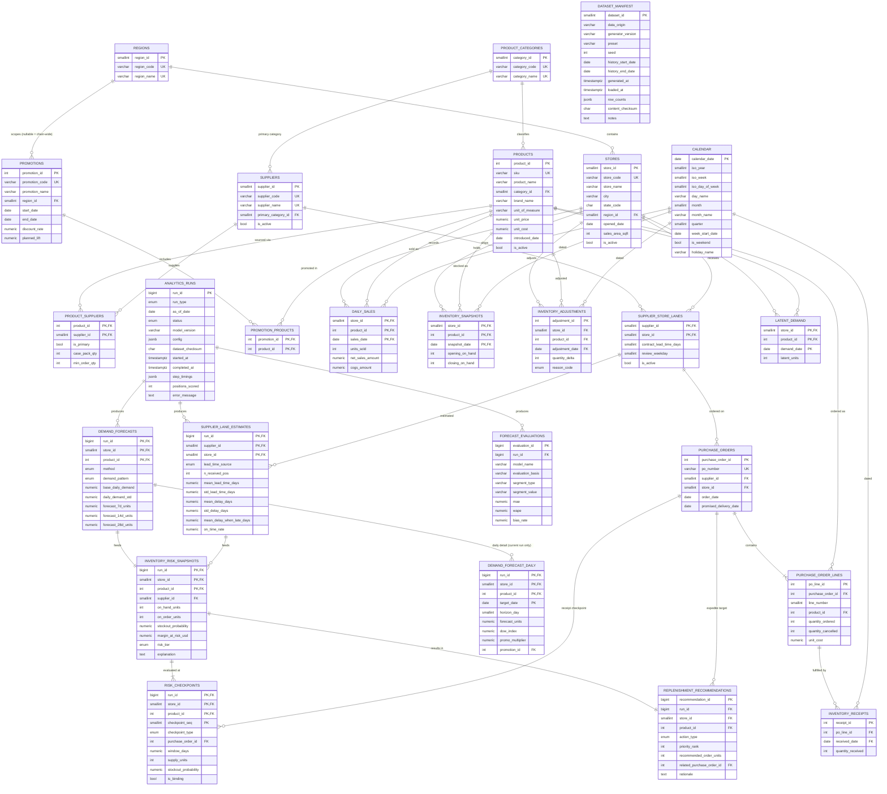
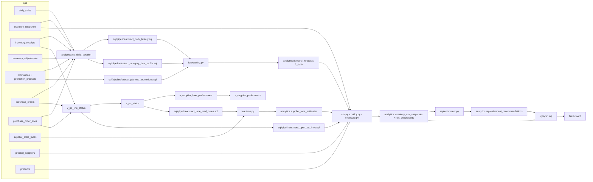

# 03 — Database Design

**Database:** PostgreSQL 17
**Related:** `04_SQL_ANALYTICS.md` (views and analyses), `05_ANALYTICS_MODELS.md` (how analytics tables are computed), `06_DATA_GENERATION.md` (how operational tables are populated)

---

## 1. Design principles

1. **Three schemas make provenance physical.**
   - `ops` — operational dimensions and transactional facts. In a real deployment these would come from POS, inventory, and procurement systems. Here they come from the deterministic simulator.
   - `analytics` — everything derived: SQL views/materialized views and versioned model outputs (forecasts, risk, recommendations, evaluations), each tagged with a `run_id`.
   - `sim_truth` — information that would be **unobservable** in a real business (latent demand). Only the backtest's simulation-only evaluation may read it.
2. **Third normal form for operational data.** Each fact is stored once. Derived facts (PO status, availability status, lead time) are computed by views.
3. **Intentional denormalization only in analytics outputs** where it makes explanations reproducible and list queries fast (documented per table in §8).
4. **Constraints over conventions.** Non-negativity, price > cost, date ordering, enumerations, and single primary supplier are enforced by the database. Cross-row rules (inventory equation, continuity) are enforced by data-quality checks (§10) because they span tables.
5. **Deterministic IDs.** Dimension and operational fact IDs are assigned by the generator (stable across runs with the same seed). Analytics tables use identity columns.
6. **Money** is `numeric(10,2)` for unit amounts and `numeric(12,2)` for extended amounts. **Quantities** of physical units are `integer`. **Forecasts and statistical values** are `numeric` with explicit scale. **Probabilities/rates** are `numeric(5,4)` on 0–1.

---

## 2. Enumerated types

Created in migration `0001`. Enum order matters where noted (PostgreSQL compares enums by declaration order).

| Type | Values (declaration order) | Notes |
|------|---------------------------|-------|
| `ops.adjustment_reason` | `shrink`, `damage`, `cycle_count_correction`, `vendor_return` | |
| `analytics.run_type` | `current`, `backfill` | |
| `analytics.run_status` | `running`, `succeeded`, `failed` | |
| `analytics.risk_tier` | `low`, `moderate`, `high`, `critical` | Ascending severity: `ORDER BY risk_tier DESC` puts Critical first |
| `analytics.action_type` | `no_action`, `monitor`, `reorder`, `expedite_po` | Ascending urgency |
| `analytics.forecast_method` | `store_sku`, `blended`, `chain_fallback`, `insufficient_data` | |
| `analytics.demand_pattern` | `smooth`, `erratic`, `intermittent`, `lumpy`, `no_demand` | |
| `analytics.distribution_family` | `normal`, `negative_binomial`, `poisson`, `degenerate` | |
| `analytics.checkpoint_type` | `receipt`, `window_end` | |
| `analytics.lead_time_source` | `lane`, `supplier`, `contract` | |
| `analytics.risk_driver` | `currently_out_of_stock`, `coverage_gap`, `no_inbound_supply`, `overdue_po`, `supplier_unreliable`, `lead_time_variability`, `demand_acceleration`, `high_demand_variability`, `recent_stockouts`, `upcoming_promotion`, `limited_history` | |

`availability_status` (`in_stock`, `sold_out`, `out_all_day`) is **derived** in `analytics.mv_daily_position` as `text` with a CHECK-equivalent CASE; it is never stored in `ops`.

---

## 3. Entity relationship diagram



---

## 4. `ops` schema — reference tables

Each table lists: purpose, columns, keys, constraints, indexes, sample row, relationships, source.

### 4.1 `ops.regions`

**Purpose:** Geographic grouping of stores; drives regional seasonality in the simulation and regional comparisons in dashboards.

| Column | Type | Null | Constraints |
|--------|------|------|-------------|
| `region_id` | `smallint` | NOT NULL | **PK** |
| `region_code` | `varchar(4)` | NOT NULL | **UNIQUE**; CHECK `region_code ~ '^[A-Z]{2}$'` |
| `region_name` | `varchar(40)` | NOT NULL | **UNIQUE** |

- **Indexes:** PK, unique indexes only.
- **Sample row:** `(1, 'SE', 'Southeast')`
- **Relationships:** 1→N `stores`; 1→N `promotions` (nullable FK on promotions).
- **Source:** Generator (`catalog.py`), fixed list.

### 4.2 `ops.stores`

**Purpose:** Retail locations (the "store" in a store-SKU position).

| Column | Type | Null | Constraints |
|--------|------|------|-------------|
| `store_id` | `smallint` | NOT NULL | **PK** |
| `store_code` | `varchar(4)` | NOT NULL | **UNIQUE**; CHECK `store_code ~ '^S[0-9]{2}$'` |
| `store_name` | `varchar(60)` | NOT NULL | |
| `city` | `varchar(40)` | NOT NULL | |
| `state_code` | `char(2)` | NOT NULL | CHECK `state_code ~ '^[A-Z]{2}$'` |
| `region_id` | `smallint` | NOT NULL | **FK** → `ops.regions(region_id)` |
| `opened_date` | `date` | NOT NULL | |
| `sales_area_sqft` | `integer` | NOT NULL | CHECK `> 0` |
| `is_active` | `boolean` | NOT NULL | DEFAULT `true` |

- **Indexes:** `ix_stores_region_id (region_id)`.
- **Sample row:** `(3, 'S03', 'Tampa Westshore', 'Tampa', 'FL', 1, '2011-05-14', 112000, true)`
- **Relationships:** N→1 `regions`; 1→N lanes, sales, snapshots, adjustments, POs.
- **Source:** Generator, fixed list (06 §3.1). City names are real US metros; store names are fictional.

### 4.3 `ops.product_categories`

**Purpose:** Merchandising categories; used for seasonality, day-of-week profiles, lost-sale assumptions, and heatmaps.

| Column | Type | Null | Constraints |
|--------|------|------|-------------|
| `category_id` | `smallint` | NOT NULL | **PK** |
| `category_code` | `varchar(4)` | NOT NULL | **UNIQUE**; CHECK `category_code ~ '^[A-Z]{2}$'` |
| `category_name` | `varchar(40)` | NOT NULL | **UNIQUE** |

- **Sample row:** `(4, 'PL', 'Plumbing')`
- **Relationships:** 1→N `products`, 1→N `suppliers` (primary category).
- **Source:** Generator, fixed list of 8.
- **Note:** Lost-sale rates are *analytics assumptions* and live in `analytics.toml`, not in this operational table.

### 4.4 `ops.suppliers`

**Purpose:** Fictional vendors that ship to stores.

| Column | Type | Null | Constraints |
|--------|------|------|-------------|
| `supplier_id` | `smallint` | NOT NULL | **PK** |
| `supplier_code` | `varchar(8)` | NOT NULL | **UNIQUE**; CHECK `supplier_code ~ '^SUP-[0-9]{3}$'` |
| `supplier_name` | `varchar(80)` | NOT NULL | **UNIQUE** |
| `primary_category_id` | `smallint` | NOT NULL | **FK** → `ops.product_categories` |
| `is_active` | `boolean` | NOT NULL | DEFAULT `true` |

- **Indexes:** `ix_suppliers_primary_category_id`.
- **Sample row:** `(21, 'SUP-021', 'Gulfmark Plumbing Supply Co.', 4, true)`
- **Source:** Generator; names composed from fictional word lists (06 §3.3).

### 4.5 `ops.products`

**Purpose:** SKU master.

| Column | Type | Null | Constraints |
|--------|------|------|-------------|
| `product_id` | `integer` | NOT NULL | **PK** |
| `sku` | `varchar(12)` | NOT NULL | **UNIQUE**; CHECK `sku ~ '^[A-Z]{2}-[0-9]{5}$'` |
| `product_name` | `varchar(120)` | NOT NULL | |
| `category_id` | `smallint` | NOT NULL | **FK** → `ops.product_categories` |
| `brand_name` | `varchar(40)` | NOT NULL | |
| `unit_of_measure` | `varchar(8)` | NOT NULL | CHECK `IN ('each','pack','bag','gallon','roll','box')` |
| `unit_price` | `numeric(10,2)` | NOT NULL | CHECK `> 0` |
| `unit_cost` | `numeric(10,2)` | NOT NULL | CHECK `> 0`; table CHECK `unit_price > unit_cost` |
| `introduced_date` | `date` | NOT NULL | |
| `is_active` | `boolean` | NOT NULL | DEFAULT `true` |

- **Indexes:** `ix_products_category_id`. (Search uses `ILIKE` over 400 rows; no trigram index needed at this scale — documented decision.)
- **Sample row:** `(187, 'PL-10187', 'Aquaveld 1/2 in. PEX-B Crimp Fitting Kit (25-Pack)', 4, 'Aquaveld', 'pack', 24.98, 15.49, '2023-02-01', true)`
- **SKU rule:** `category_code || '-' || (10000 + product_id)`.
- **Source:** Generator (06 §3.4).

### 4.6 `ops.product_suppliers`

**Purpose:** Which suppliers can supply which product, with ordering constraints. Exactly one primary supplier per product.

| Column | Type | Null | Constraints |
|--------|------|------|-------------|
| `product_id` | `integer` | NOT NULL | **PK (1/2)**, **FK** → `ops.products` |
| `supplier_id` | `smallint` | NOT NULL | **PK (2/2)**, **FK** → `ops.suppliers` |
| `is_primary` | `boolean` | NOT NULL | |
| `case_pack_qty` | `integer` | NOT NULL | CHECK `> 0` |
| `min_order_qty` | `integer` | NOT NULL | CHECK `> 0`; CHECK `min_order_qty % case_pack_qty = 0` |

- **Indexes:** `ix_product_suppliers_supplier_id (supplier_id)`; **partial unique** `ux_product_suppliers_one_primary ON (product_id) WHERE is_primary`.
- **Sample row:** `(187, 21, true, 12, 24)`
- **Source:** Generator. ~20% of products have a secondary (non-primary) supplier, used only by P2 features.

### 4.7 `ops.supplier_store_lanes`

**Purpose:** A supplier→store replenishment lane with its contracted lead time and weekly review (ordering) day. Lead-time analytics are estimated per lane.

| Column | Type | Null | Constraints |
|--------|------|------|-------------|
| `supplier_id` | `smallint` | NOT NULL | **PK (1/2)**, **FK** → `ops.suppliers` |
| `store_id` | `smallint` | NOT NULL | **PK (2/2)**, **FK** → `ops.stores` |
| `contract_lead_time_days` | `smallint` | NOT NULL | CHECK `BETWEEN 1 AND 60` |
| `review_weekday` | `smallint` | NOT NULL | CHECK `BETWEEN 1 AND 7` (ISO: 1 = Monday) |
| `is_active` | `boolean` | NOT NULL | DEFAULT `true` |

- **Indexes:** `ix_lanes_store_id (store_id)`.
- **Sample row:** `(21, 3, 9, 2, true)` — supplier 21 ships to Tampa with a 9-day contract lead time; orders reviewed Tuesdays.
- **Source:** Generator. 576 rows in the standard preset.

### 4.8 `ops.calendar`

**Purpose:** Date dimension for weekly grouping, day-of-week, holidays; FK target for all dated facts.

| Column | Type | Null | Constraints |
|--------|------|------|-------------|
| `calendar_date` | `date` | NOT NULL | **PK** |
| `iso_year` | `smallint` | NOT NULL | |
| `iso_week` | `smallint` | NOT NULL | CHECK `BETWEEN 1 AND 53` |
| `iso_day_of_week` | `smallint` | NOT NULL | CHECK `BETWEEN 1 AND 7` |
| `day_name` | `varchar(9)` | NOT NULL | |
| `month` | `smallint` | NOT NULL | CHECK `BETWEEN 1 AND 12` |
| `month_name` | `varchar(9)` | NOT NULL | |
| `quarter` | `smallint` | NOT NULL | CHECK `BETWEEN 1 AND 4` |
| `week_start_date` | `date` | NOT NULL | Monday of the ISO week |
| `is_weekend` | `boolean` | NOT NULL | |
| `holiday_name` | `varchar(40)` | NULL | |

- **Indexes:** `ix_calendar_week_start_date`.
- **Coverage:** `history_start − 35 days` through `history_end + 90 days` (covers burn-in POs and the forecast horizon).
- **Sample row:** `('2026-09-07', 2026, 37, 1, 'Monday', 9, 'September', 3, '2026-09-07', false, 'Labor Day')`
- **Source:** Generator (`catalog.py`), derived deterministically from the date range.

### 4.9 `ops.promotions`

**Purpose:** Planned promotional events with discount and **planned** demand lift (the merchandising plan, known in advance).

| Column | Type | Null | Constraints |
|--------|------|------|-------------|
| `promotion_id` | `integer` | NOT NULL | **PK** |
| `promotion_code` | `varchar(12)` | NOT NULL | **UNIQUE**; CHECK `promotion_code ~ '^PRM-[0-9]{4}$'` |
| `promotion_name` | `varchar(80)` | NOT NULL | |
| `region_id` | `smallint` | NULL | **FK** → `ops.regions`; NULL = all regions |
| `start_date` | `date` | NOT NULL | |
| `end_date` | `date` | NOT NULL | CHECK `end_date >= start_date`; CHECK `end_date - start_date <= 30` |
| `discount_rate` | `numeric(4,3)` | NOT NULL | CHECK `discount_rate > 0 AND discount_rate < 0.6` |
| `planned_lift` | `numeric(4,2)` | NOT NULL | CHECK `planned_lift BETWEEN 1.00 AND 3.00` (demand multiplier) |

- **Indexes:** `ix_promotions_dates (start_date, end_date)`.
- **Sample row:** `(31, 'PRM-0031', 'Fall Plumbing Repair Event', NULL, '2026-10-05', '2026-10-14', 0.150, 1.35)`
- **Source:** Generator. Promotions are generated through `history_end + 42 days` so planned future promotions exist for forecasting.

### 4.10 `ops.promotion_products`

**Purpose:** Products included in each promotion (M:N).

| Column | Type | Null | Constraints |
|--------|------|------|-------------|
| `promotion_id` | `integer` | NOT NULL | **PK (1/2)**, **FK** → `ops.promotions` ON DELETE CASCADE |
| `product_id` | `integer` | NOT NULL | **PK (2/2)**, **FK** → `ops.products` |

- **Indexes:** `ix_promotion_products_product_id (product_id)`.
- **Rule (DQ check DQ09):** a product may not be in two promotions whose date ranges overlap and whose region scopes overlap.
- **Sample row:** `(31, 192)`

### 4.11 `ops.dataset_manifest`

**Purpose:** Single-row provenance record for the loaded dataset. Served by `GET /api/v1/meta`.

| Column | Type | Null | Constraints |
|--------|------|------|-------------|
| `dataset_id` | `smallint` | NOT NULL | **PK**; CHECK `dataset_id = 1` |
| `data_origin` | `varchar(20)` | NOT NULL | CHECK `IN ('synthetic','public')` |
| `generator_version` | `varchar(20)` | NOT NULL | |
| `preset` | `varchar(20)` | NOT NULL | CHECK `IN ('small','standard','large')` |
| `seed` | `integer` | NOT NULL | |
| `history_start_date` | `date` | NOT NULL | |
| `history_end_date` | `date` | NOT NULL | CHECK `history_end_date > history_start_date` |
| `generated_at` | `timestamptz` | NOT NULL | |
| `loaded_at` | `timestamptz` | NOT NULL | DEFAULT `now()` |
| `row_counts` | `jsonb` | NOT NULL | e.g. `{"daily_sales": 864000, …}` |
| `content_checksum` | `char(64)` | NOT NULL | SHA-256 over CSV files in sorted order |
| `notes` | `text` | NOT NULL | Provenance statement |

- **Sample row:** `(1, 'synthetic', '1.0.0', 'standard', 42, '2026-04-04', '2026-09-30', '2026-10-09T19:02:11Z', '2026-10-09T19:03:40Z', {...}, 'a3f9…', 'Simulated retail dataset generated by StockSense. Not real company data.')`

---

## 5. `ops` schema — operational fact tables

### 5.1 Daily inventory equation (binding definition)

For every store `s`, product `p`, date `d` in the history window:

```
available_units(s,p,d) = opening_on_hand(s,p,d) + units_received(s,p,d)
units_sold(s,p,d)      ≤ available_units(s,p,d)
closing_on_hand(s,p,d) = opening_on_hand(s,p,d) + units_received(s,p,d) − units_sold(s,p,d) + net_adjustment(s,p,d)
opening_on_hand(s,p,d) = closing_on_hand(s,p,d − 1)        (for d > history_start)
closing_on_hand(s,p,d) ≥ 0
```

where `units_received` = Σ `inventory_receipts.quantity_received` for PO lines of store `s` and product `p` received on `d`, and `net_adjustment` = Σ `inventory_adjustments.quantity_delta` (signed) on `d`.

**Intra-day event order (simulation and interpretation):** receipts at start of day → sales during day → adjustments at end of day. Therefore receipts are sellable the day they arrive, and a day's availability status depends only on `available_units` and `units_sold`.

### 5.2 `ops.daily_sales`

**Purpose:** Observed sales per store-SKU-day. **Dense:** one row for every store × product × history date, including zero-sale days.

| Column | Type | Null | Constraints |
|--------|------|------|-------------|
| `store_id` | `smallint` | NOT NULL | **PK (1/3)**, **FK** → `ops.stores` |
| `product_id` | `integer` | NOT NULL | **PK (2/3)**, **FK** → `ops.products` |
| `sales_date` | `date` | NOT NULL | **PK (3/3)**, **FK** → `ops.calendar` |
| `units_sold` | `integer` | NOT NULL | CHECK `>= 0` |
| `net_sales_amount` | `numeric(12,2)` | NOT NULL | CHECK `>= 0` |
| `cogs_amount` | `numeric(12,2)` | NOT NULL | CHECK `>= 0` |

- Table CHECK: `units_sold > 0 OR (net_sales_amount = 0 AND cogs_amount = 0)`.
- **Indexes:** PK btree `(store_id, product_id, sales_date)` serves per-position time ranges; `brin_daily_sales_sales_date` **BRIN** on `(sales_date)` serves chain-wide date-range aggregates (data is loaded ordered by date, so BRIN is effective and tiny).
- **Sample row:** `(3, 187, '2026-09-29', 11, 274.78, 170.39)`
- **Source:** Generator. `net_sales_amount = units × unit_price × (1 − discount_rate if promoted)`, rounded to cents; `cogs_amount = units × unit_cost`.
- **Rows (standard):** 864,000.
- **Why dense:** zero is information (especially for distinguishing true zero demand from stockouts), and dense rows make `ROWS BETWEEN n PRECEDING` windows equal calendar windows.

### 5.3 `ops.inventory_snapshots`

**Purpose:** End-of-day and start-of-day physical on-hand balance per store-SKU-day. **Dense.**

| Column | Type | Null | Constraints |
|--------|------|------|-------------|
| `store_id` | `smallint` | NOT NULL | **PK (1/3)**, **FK** → `ops.stores` |
| `product_id` | `integer` | NOT NULL | **PK (2/3)**, **FK** → `ops.products` |
| `snapshot_date` | `date` | NOT NULL | **PK (3/3)**, **FK** → `ops.calendar` |
| `opening_on_hand` | `integer` | NOT NULL | CHECK `>= 0` |
| `closing_on_hand` | `integer` | NOT NULL | CHECK `>= 0` |

- **Indexes:** PK; `ix_inventory_snapshots_date (snapshot_date)` btree — the risk pipeline reads all 4,800 positions for one date.
- **Sample row:** `(3, 187, '2026-09-30', 111, 100)`
- **Source:** Generator.
- **Intentional redundancy:** `opening_on_hand` equals the previous day's `closing_on_hand`. It is kept as an explicit **continuity control**: DQ02 verifies it using `LAG()`, and it makes the first history day self-contained. Units sold/received are **not** duplicated here; they are reconciled from their own tables (DQ01).

### 5.4 `ops.purchase_orders`

**Purpose:** Purchase order headers. One PO = one supplier, one store, one order date.

| Column | Type | Null | Constraints |
|--------|------|------|-------------|
| `purchase_order_id` | `integer` | NOT NULL | **PK** |
| `po_number` | `varchar(12)` | NOT NULL | **UNIQUE**; CHECK `po_number ~ '^PO-[0-9]{6}$'` |
| `supplier_id` | `smallint` | NOT NULL | **FK (composite)** `(supplier_id, store_id)` → `ops.supplier_store_lanes` |
| `store_id` | `smallint` | NOT NULL | (part of composite FK); **FK** → `ops.stores` |
| `order_date` | `date` | NOT NULL | **FK** → `ops.calendar` |
| `promised_delivery_date` | `date` | NOT NULL | CHECK `promised_delivery_date > order_date` |

- **Indexes:** `ix_po_store_order_date (store_id, order_date)`; `ix_po_supplier_promised (supplier_id, promised_delivery_date)`.
- **Sample row:** `(104233, 'PO-104233', 21, 3, '2026-09-22', '2026-10-01')`
- **Source:** Generator's legacy replenishment policy (06 §6). Some POs have `order_date` before `history_start` (burn-in) when their receipts fall inside the window.
- **Status is not stored.** It is derived in `analytics.v_po_status` (open / partially received / received / closed short) from lines and receipts, preventing inconsistency.

### 5.5 `ops.purchase_order_lines`

**Purpose:** Products and quantities on each PO.

| Column | Type | Null | Constraints |
|--------|------|------|-------------|
| `po_line_id` | `integer` | NOT NULL | **PK** |
| `purchase_order_id` | `integer` | NOT NULL | **FK** → `ops.purchase_orders` ON DELETE CASCADE |
| `line_number` | `smallint` | NOT NULL | CHECK `>= 1` |
| `product_id` | `integer` | NOT NULL | **FK** → `ops.products` |
| `quantity_ordered` | `integer` | NOT NULL | CHECK `> 0` |
| `quantity_cancelled` | `integer` | NOT NULL | DEFAULT 0; CHECK `quantity_cancelled >= 0 AND quantity_cancelled <= quantity_ordered` |
| `unit_cost` | `numeric(10,2)` | NOT NULL | CHECK `> 0` |

- **Unique:** `(purchase_order_id, line_number)`, `(purchase_order_id, product_id)`.
- **Indexes:** `ix_po_lines_product_id (product_id)`.
- **Derived (never stored):** `quantity_received` = Σ receipts; `open_quantity = quantity_ordered − quantity_received − quantity_cancelled`.
- **Sample row:** `(390118, 104233, 1, 187, 96, 0, 15.49)`
- **Cross-table rule (DQ07):** `(product_id, purchase_orders.supplier_id)` must exist in `ops.product_suppliers`.

### 5.6 `ops.inventory_receipts`

**Purpose:** Physical receipt events against PO lines (supports partial deliveries).

| Column | Type | Null | Constraints |
|--------|------|------|-------------|
| `receipt_id` | `integer` | NOT NULL | **PK** |
| `po_line_id` | `integer` | NOT NULL | **FK** → `ops.purchase_order_lines` ON DELETE CASCADE |
| `received_date` | `date` | NOT NULL | **FK** → `ops.calendar` |
| `quantity_received` | `integer` | NOT NULL | CHECK `> 0` |

- **Unique:** `(po_line_id, received_date)`.
- **Indexes:** `ix_receipts_received_date (received_date)`; unique index covers `po_line_id` lookups.
- **Sample row:** `(512904, 389001, '2026-09-24', 48)`
- **Cross-table rules:** DQ05 (`received + cancelled ≤ ordered`), DQ06 (`received_date > order_date`), DQ12 (`received_date ≤ history_end`).
- **Design note:** `store_id`/`product_id` are not duplicated here; they are reached via line → header. The materialized view handles the join once.

### 5.7 `ops.inventory_adjustments`

**Purpose:** Non-sale inventory changes (shrink, damage, cycle-count corrections, vendor returns). Signed deltas.

| Column | Type | Null | Constraints |
|--------|------|------|-------------|
| `adjustment_id` | `integer` | NOT NULL | **PK** |
| `store_id` | `smallint` | NOT NULL | **FK** → `ops.stores` |
| `product_id` | `integer` | NOT NULL | **FK** → `ops.products` |
| `adjustment_date` | `date` | NOT NULL | **FK** → `ops.calendar` |
| `quantity_delta` | `integer` | NOT NULL | CHECK `quantity_delta <> 0` |
| `reason_code` | `ops.adjustment_reason` | NOT NULL | CHECK `reason_code = 'cycle_count_correction' OR quantity_delta < 0` |

- **Unique:** `(store_id, product_id, adjustment_date, reason_code)`.
- **Sample row:** `(77120, 3, 187, '2026-09-18', -2, 'shrink')`
- **Source:** Generator (06 §5.6).

---

## 6. `analytics` schema — model output tables

All output tables carry `run_id` and cascade-delete with their run. The API reads the **current run** = latest `succeeded` run with `run_type = 'current'`, ordered by `as_of_date DESC, completed_at DESC` (view `analytics.v_current_run`).

### 6.1 `analytics.analytics_runs`

**Purpose:** One row per analytics execution; lineage anchor.

| Column | Type | Null | Constraints |
|--------|------|------|-------------|
| `run_id` | `bigint` | NOT NULL | **PK**, `GENERATED ALWAYS AS IDENTITY` |
| `run_type` | `analytics.run_type` | NOT NULL | |
| `as_of_date` | `date` | NOT NULL | FK → `ops.calendar` |
| `status` | `analytics.run_status` | NOT NULL | DEFAULT `'running'` |
| `model_version` | `varchar(40)` | NOT NULL | e.g. `stocksense-baseline-1.0` |
| `config` | `jsonb` | NOT NULL | Full parsed `AnalyticsConfig` |
| `dataset_checksum` | `char(64)` | NOT NULL | Copied from `ops.dataset_manifest.content_checksum` |
| `started_at` | `timestamptz` | NOT NULL | DEFAULT `now()` |
| `completed_at` | `timestamptz` | NULL | CHECK `status <> 'succeeded' OR completed_at IS NOT NULL` |
| `step_timings` | `jsonb` | NULL | `{"extract_ms": 812, "forecast_ms": 2310, …}` |
| `positions_scored` | `integer` | NULL | CHECK `>= 0` |
| `error_message` | `text` | NULL | CHECK `status <> 'failed' OR error_message IS NOT NULL` |

- **Indexes:** `ix_runs_status_type_asof (status, run_type, as_of_date DESC, completed_at DESC)`.
- **Sample row:** `(14, 'current', '2026-09-30', 'succeeded', 'stocksense-baseline-1.0', {...}, 'a3f9…', '2026-10-09T19:05:02Z', '2026-10-09T19:05:21Z', {...}, 4800, NULL)`
- **Retention:** `stocksense analytics run` deletes older runs of the same `(run_type, as_of_date)` after a new run succeeds (keeps history compact and avoids ambiguous duplicates).

### 6.2 `analytics.demand_forecasts`

**Purpose:** Per-position forecast summary and the statistics used downstream.

| Column | Type | Null | Constraints / meaning |
|--------|------|------|-----------------------|
| `run_id` | `bigint` | NOT NULL | **PK (1/3)**, **FK** → `analytics_runs` ON DELETE CASCADE |
| `store_id` | `smallint` | NOT NULL | **PK (2/3)**, **FK** → `ops.stores` |
| `product_id` | `integer` | NOT NULL | **PK (3/3)**, **FK** → `ops.products` |
| `method` | `analytics.forecast_method` | NOT NULL | Which estimation path was used (05 §3.6) |
| `demand_pattern` | `analytics.demand_pattern` | NOT NULL | Syntetos–Boylan class |
| `lookback_days` | `smallint` | NOT NULL | CHECK `> 0` (56) |
| `clean_days` | `smallint` | NOT NULL | CHECK `>= 0`; in-stock, non-promo days used for estimation |
| `censored_days` | `smallint` | NOT NULL | CHECK `>= 0`; sold_out + out_all_day days excluded |
| `promo_days` | `smallint` | NOT NULL | CHECK `>= 0`; in-stock promo days excluded from level |
| `base_daily_demand` | `numeric(12,4)` | NOT NULL | CHECK `>= 0`; deseasonalized level `ℓ` (units/day) |
| `daily_demand_std` | `numeric(12,4)` | NOT NULL | CHECK `>= 0`; `σ_d` after Poisson floor |
| `observed_demand_cv` | `numeric(8,4)` | NULL | `σ_obs / ℓ`; NULL when `ℓ = 0` |
| `demand_trend_ratio` | `numeric(8,4)` | NULL | Recent 14-day clean mean ÷ prior 42-day clean mean; NULL if insufficient days |
| `adi` | `numeric(8,3)` | NULL | Average inter-demand interval (clean days) |
| `cv_squared` | `numeric(8,4)` | NULL | Squared CV of non-zero clean-day demand |
| `forecast_7d_units` | `numeric(12,2)` | NOT NULL | CHECK `>= 0`; Σ daily forecasts days 1–7 |
| `forecast_14d_units` | `numeric(12,2)` | NOT NULL | CHECK `>= forecast_7d_units` |
| `forecast_28d_units` | `numeric(12,2)` | NOT NULL | CHECK `>= forecast_14d_units` |
| `forecast_7d_std_units` | `numeric(12,2)` | NOT NULL | `σ_d·√7` |
| `forecast_14d_std_units` | `numeric(12,2)` | NOT NULL | `σ_d·√14` |
| `forecast_28d_std_units` | `numeric(12,2)` | NOT NULL | `σ_d·√28` |

- **Indexes:** PK only (lookups always by run + position or full run scans).
- **Sample row:** `(14, 3, 187, 'store_sku', 'smooth', 56, 49, 4, 3, 12.0000, 5.0000, 0.4167, 1.0810, 1.000, 0.1544, 84.00, 168.00, 336.00, 13.23, 18.71, 26.46)`

### 6.3 `analytics.demand_forecast_daily`

**Purpose:** Daily forecast detail for the inventory projection chart and for exact window sums. **Stored only for `current` runs** (backfill runs omit it to control storage — 201,600 rows per run).

| Column | Type | Null | Constraints |
|--------|------|------|-------------|
| `run_id` | `bigint` | NOT NULL | **PK (1/4)** |
| `store_id` | `smallint` | NOT NULL | **PK (2/4)** |
| `product_id` | `integer` | NOT NULL | **PK (3/4)** |
| `target_date` | `date` | NOT NULL | **PK (4/4)**, FK → `ops.calendar` |
| `horizon_day` | `smallint` | NOT NULL | CHECK `BETWEEN 1 AND 42`; `target_date = as_of_date + horizon_day` |
| `forecast_units` | `numeric(12,4)` | NOT NULL | CHECK `>= 0` |
| `dow_index` | `numeric(6,4)` | NOT NULL | CHECK `> 0` |
| `promo_multiplier` | `numeric(4,2)` | NOT NULL | CHECK `>= 1.00` |
| `promotion_id` | `integer` | NULL | FK → `ops.promotions` |

- **FK:** `(run_id, store_id, product_id)` → `analytics.demand_forecasts` ON DELETE CASCADE.
- **Sample row:** `(14, 3, 187, '2026-10-03', 3, 12.0000, 1.0000, 1.00, NULL)` (the hero example assumes a flat day-of-week profile for readability; real rows vary by weekday)

### 6.4 `analytics.forecast_evaluations`

**Purpose:** Rolling-origin backtest metrics (05 §3.9), per model, basis, and segment.

| Column | Type | Null | Constraints |
|--------|------|------|-------------|
| `evaluation_id` | `bigint` | NOT NULL | **PK**, identity |
| `run_id` | `bigint` | NOT NULL | **FK** → `analytics_runs` ON DELETE CASCADE |
| `model_name` | `varchar(40)` | NOT NULL | CHECK `IN ('stocksense_v1','naive_28d_mean','seasonal_naive_7d')` |
| `evaluation_basis` | `varchar(20)` | NOT NULL | CHECK `IN ('observed_in_stock','simulated_latent')` |
| `segment_type` | `varchar(20)` | NOT NULL | CHECK `IN ('overall','horizon_bucket','velocity_class','demand_pattern')` |
| `segment_value` | `varchar(20)` | NOT NULL | e.g. `all`, `1-7`, `8-14`, `15-28`, `A`, `B`, `C`, `smooth` |
| `n_origins` | `smallint` | NOT NULL | CHECK `> 0` |
| `n_observations` | `integer` | NOT NULL | CHECK `>= 0` |
| `actual_units` | `numeric(14,2)` | NOT NULL | |
| `forecast_units` | `numeric(14,2)` | NOT NULL | |
| `abs_error_units` | `numeric(14,2)` | NOT NULL | |
| `mae` | `numeric(12,4)` | NULL | NULL when `n_observations = 0` |
| `wape` | `numeric(8,4)` | NULL | NULL when `actual_units = 0` |
| `bias_rate` | `numeric(8,4)` | NULL | `(Σf − Σa)/Σa`; NULL when `actual_units = 0` |
| `first_origin_date` | `date` | NOT NULL | |
| `last_origin_date` | `date` | NOT NULL | |

- **Unique:** `(run_id, model_name, evaluation_basis, segment_type, segment_value)`.
- **Sample row:** `(201, 14, 'stocksense_v1', 'observed_in_stock', 'overall', 'all', 8, 1043211, …)` (values produced at runtime; none are pre-specified).

### 6.5 `analytics.supplier_lane_estimates`

**Purpose:** Point-in-time lead-time and delivery statistics per lane used by the risk engine (05 §4).

| Column | Type | Null | Constraints |
|--------|------|------|-------------|
| `run_id` | `bigint` | NOT NULL | **PK (1/3)**, FK → runs ON DELETE CASCADE |
| `supplier_id` | `smallint` | NOT NULL | **PK (2/3)** |
| `store_id` | `smallint` | NOT NULL | **PK (3/3)** |
| `lead_time_source` | `analytics.lead_time_source` | NOT NULL | |
| `n_received_pos` | `integer` | NOT NULL | CHECK `>= 0` (lane-level count, even if fallback used) |
| `mean_lead_time_days` | `numeric(6,2)` | NOT NULL | CHECK `> 0` |
| `std_lead_time_days` | `numeric(6,2)` | NOT NULL | CHECK `>= 0` |
| `mean_delay_days` | `numeric(6,2)` | NOT NULL | Mean of (first receipt − promised); may be negative |
| `std_delay_days` | `numeric(6,2)` | NOT NULL | CHECK `>= 0` |
| `mean_delay_when_late_days` | `numeric(6,2)` | NOT NULL | CHECK `>= 0` |
| `on_time_rate` | `numeric(5,4)` | NULL | CHECK `BETWEEN 0 AND 1` |

- **FK:** `(supplier_id, store_id)` → `ops.supplier_store_lanes`.
- **Sample row:** `(14, 21, 3, 'lane', 27, 10.00, 2.00, 0.92, 1.88, 3.10, 0.7037)`

### 6.6 `analytics.inventory_risk_snapshots`

**Purpose:** The central output: every input and output needed to explain one position's risk, at one run.

| Column | Type | Null | Meaning (formulas in 05) |
|--------|------|------|--------------------------|
| `run_id` | `bigint` | NOT NULL | **PK (1/3)** |
| `store_id` | `smallint` | NOT NULL | **PK (2/3)** |
| `product_id` | `integer` | NOT NULL | **PK (3/3)** |
| `supplier_id` | `smallint` | NOT NULL | Primary supplier at run time |
| `on_hand_units` | `integer` | NOT NULL | CHECK `>= 0`; closing on hand at as-of |
| `on_order_units` | `integer` | NOT NULL | CHECK `>= 0`; Σ open PO quantity |
| `inventory_position_units` | `integer` | NOT NULL | CHECK `= on_hand_units + on_order_units` |
| `open_po_count` | `smallint` | NOT NULL | CHECK `>= 0` |
| `next_receipt_date` | `date` | NULL | Expected arrival of the earliest open PO |
| `next_receipt_units` | `integer` | NULL | CHECK `> 0` when not NULL |
| `next_receipt_po_id` | `integer` | NULL | FK → `ops.purchase_orders` |
| `next_receipt_overdue` | `boolean` | NOT NULL | DEFAULT false |
| `avg_daily_demand_units` | `numeric(12,4)` | NOT NULL | `forecast_28d_units / 28` |
| `daily_demand_std_units` | `numeric(12,4)` | NOT NULL | `σ_d` |
| `days_of_cover` | `numeric(8,1)` | NULL | `on_hand / avg_daily_demand`, capped 365; NULL if demand = 0 |
| `lead_time_mean_days` | `numeric(6,2)` | NOT NULL | `L̄` |
| `lead_time_std_days` | `numeric(6,2)` | NOT NULL | `σ_L` |
| `protection_window_days` | `numeric(6,2)` | NOT NULL | `= lead_time_mean_days` |
| `lead_time_demand_mean_units` | `numeric(12,2)` | NOT NULL | `μ_LTD` |
| `lead_time_demand_std_units` | `numeric(12,2)` | NOT NULL | `σ_LTD` |
| `distribution_family` | `analytics.distribution_family` | NOT NULL | For the lead-time demand distribution |
| `service_level` | `numeric(5,4)` | NOT NULL | CHECK `BETWEEN 0.5 AND 0.9999` |
| `safety_stock_units` | `numeric(12,2)` | NOT NULL | CHECK `>= 0` |
| `reorder_point_units` | `integer` | NOT NULL | CHECK `>= 0` |
| `order_up_to_units` | `integer` | NOT NULL | CHECK `>= reorder_point_units` |
| `below_reorder_point` | `boolean` | NOT NULL | `inventory_position_units <= reorder_point_units AND order_up_to_units > inventory_position_units` (05 §6.3) |
| `binding_checkpoint_type` | `analytics.checkpoint_type` | NOT NULL | Checkpoint with max probability |
| `binding_window_days` | `numeric(6,2)` | NOT NULL | |
| `binding_supply_units` | `integer` | NOT NULL | |
| `binding_demand_mean_units` | `numeric(12,2)` | NOT NULL | |
| `binding_demand_std_units` | `numeric(12,2)` | NOT NULL | |
| `stockout_probability` | `numeric(5,4)` | NOT NULL | CHECK `BETWEEN 0 AND 1` |
| `expected_shortage_units` | `numeric(12,2)` | NOT NULL | CHECK `>= 0` |
| `lost_sale_rate` | `numeric(4,3)` | NOT NULL | Category assumption applied |
| `expected_lost_units` | `numeric(12,2)` | NOT NULL | CHECK `>= 0` |
| `revenue_at_risk_usd` | `numeric(12,2)` | NOT NULL | CHECK `>= 0` |
| `margin_at_risk_usd` | `numeric(12,2)` | NOT NULL | CHECK `>= 0` |
| `projected_stockout_date` | `date` | NULL | From expected-value projection (05 §5.8) |
| `days_until_projected_stockout` | `smallint` | NULL | CHECK `BETWEEN 1 AND 42` |
| `currently_out_of_stock` | `boolean` | NOT NULL | `on_hand_units = 0` |
| `recent_censored_days` | `smallint` | NOT NULL | Censored days in last 28 |
| `risk_tier` | `analytics.risk_tier` | NOT NULL | |
| `risk_drivers` | `analytics.risk_driver[]` | NOT NULL | DEFAULT `'{}'` |
| `explanation` | `text` | NOT NULL | Deterministic plain-language text |

- **FKs:** `(run_id, store_id, product_id)` → `analytics.demand_forecasts` ON DELETE CASCADE; `(run_id, supplier_id, store_id)` → `analytics.supplier_lane_estimates`.
- **Indexes:** `ix_risk_run_tier_margin (run_id, risk_tier DESC, margin_at_risk_usd DESC)`; `ix_risk_run_store (run_id, store_id)`; `ix_risk_run_supplier (run_id, supplier_id)`; `ix_risk_run_product (run_id, product_id)`.
- **Sample row (hero example, 05 §13.1):** `(14, 3, 187, 21, 100, 0, 100, 0, NULL, NULL, NULL, false, 12.0000, 5.0000, 8.3, 10.00, 2.00, 10.00, 120.00, 28.74, 'normal', 0.9500, 47.27, 168, 257, true, 'window_end', 10.00, 100, 120.00, 28.74, 0.7568, 24.14, 0.650, 15.69, 391.88, 148.88, '2026-10-09', 9, false, 2, 'critical', '{coverage_gap,no_inbound_supply,supplier_unreliable}', 'On-hand inventory of 100 units covers about 8 days …')`
- **Intentional denormalization:** `binding_*` columns duplicate the binding row of `risk_checkpoints` so list endpoints don't need a join; `supplier_id` duplicates the primary-supplier lookup **as of the run** (point-in-time correctness if suppliers change later).

### 6.7 `analytics.risk_checkpoints`

**Purpose:** Every checkpoint evaluated for a position (05 §5.5), for the "how risk was calculated" breakdown.

| Column | Type | Null | Constraints |
|--------|------|------|-------------|
| `run_id` | `bigint` | NOT NULL | **PK (1/4)** |
| `store_id` | `smallint` | NOT NULL | **PK (2/4)** |
| `product_id` | `integer` | NOT NULL | **PK (3/4)** |
| `checkpoint_seq` | `smallint` | NOT NULL | **PK (4/4)**; CHECK `>= 1`, ordered by window length |
| `checkpoint_type` | `analytics.checkpoint_type` | NOT NULL | |
| `purchase_order_id` | `integer` | NULL | FK → `ops.purchase_orders`; CHECK `(checkpoint_type = 'receipt') = (purchase_order_id IS NOT NULL)` |
| `arrival_date` | `date` | NULL | Expected arrival (receipt checkpoints) |
| `window_days` | `numeric(6,2)` | NOT NULL | CHECK `>= 0`; days of demand before this point |
| `window_std_days` | `numeric(6,2)` | NOT NULL | CHECK `>= 0` |
| `supply_units` | `integer` | NOT NULL | CHECK `>= 0`; on hand + receipts strictly before this point |
| `demand_mean_units` | `numeric(12,2)` | NOT NULL | |
| `demand_std_units` | `numeric(12,2)` | NOT NULL | |
| `distribution_family` | `analytics.distribution_family` | NOT NULL | |
| `stockout_probability` | `numeric(5,4)` | NOT NULL | CHECK `BETWEEN 0 AND 1` |
| `expected_shortage_units` | `numeric(12,2)` | NOT NULL | CHECK `>= 0` |
| `is_binding` | `boolean` | NOT NULL | |

- **FK:** `(run_id, store_id, product_id)` → `analytics.inventory_risk_snapshots` ON DELETE CASCADE.
- **Partial unique:** `ux_checkpoints_one_binding ON (run_id, store_id, product_id) WHERE is_binding`.
- **Sample row:** `(14, 3, 187, 1, 'window_end', NULL, NULL, 10.00, 2.00, 100, 120.00, 28.74, 'normal', 0.7568, 24.14, true)`

### 6.8 `analytics.replenishment_recommendations`

**Purpose:** One recommendation per position per run (including `no_action`), with priority rank.

| Column | Type | Null | Constraints |
|--------|------|------|-------------|
| `recommendation_id` | `bigint` | NOT NULL | **PK**, identity |
| `run_id` | `bigint` | NOT NULL | |
| `store_id` | `smallint` | NOT NULL | |
| `product_id` | `integer` | NOT NULL | |
| `supplier_id` | `smallint` | NOT NULL | FK → `ops.suppliers` |
| `action_type` | `analytics.action_type` | NOT NULL | |
| `urgency` | `varchar(10)` | NULL | CHECK `urgency IN ('urgent','standard')`; NULL iff `no_action` |
| `priority_rank` | `integer` | NULL | CHECK `priority_rank >= 1`; CHECK `(action_type = 'no_action') = (priority_rank IS NULL)` |
| `recommended_order_units` | `integer` | NULL | CHECK `>= 0`; populated whenever below reorder point |
| `recommended_order_cost_usd` | `numeric(12,2)` | NULL | `units × unit_cost` |
| `related_purchase_order_id` | `integer` | NULL | FK → `ops.purchase_orders`; CHECK `action_type <> 'expedite_po' OR related_purchase_order_id IS NOT NULL` |
| `rationale` | `text` | NOT NULL | One sentence explaining the action |

- **Unique:** `(run_id, store_id, product_id)`; `(run_id, priority_rank)` (partial, `WHERE priority_rank IS NOT NULL`).
- **FK:** `(run_id, store_id, product_id)` → `analytics.inventory_risk_snapshots` ON DELETE CASCADE.
- **Table CHECK:** `action_type <> 'reorder' OR recommended_order_units > 0`.
- **Sample row:** `(88231, 14, 3, 187, 21, 'reorder', 'urgent', 3, 168, 2602.32, NULL, 'Inventory position (100) is at or below the reorder point (168). Order 168 units (14 cases of 12) to reach the target stock position of 257.')`

---

## 7. `sim_truth` schema

### 7.1 `sim_truth.latent_demand`

**Purpose:** True customer demand generated by the simulator before the stock constraint. **Not observable in real operations.**

| Column | Type | Null | Constraints |
|--------|------|------|-------------|
| `store_id` | `smallint` | NOT NULL | **PK (1/3)**, FK → `ops.stores` |
| `product_id` | `integer` | NOT NULL | **PK (2/3)**, FK → `ops.products` |
| `demand_date` | `date` | NOT NULL | **PK (3/3)**, FK → `ops.calendar` |
| `latent_units` | `integer` | NOT NULL | CHECK `>= 0` |

- **Access rule:** Only `analytics/backtest.py` (via `sql/pipeline/extract_latent_demand.sql`) and DQ15 may read this table. Enforced by a repository grep test (02 §6). The API never exposes row-level latent demand; it exposes only aggregate simulation-only evaluation metrics labeled as such.
- **Sample row:** `(3, 187, '2026-09-29', 11)`
- **Rule (DQ15):** `latent_units >= daily_sales.units_sold` for every position-day; equality is expected except on sold-out/out-all-day days.

---

## 8. Normalization and denormalization decisions

| Decision | Normal form impact | Justification |
|----------|-------------------|---------------|
| PO status derived, not stored | Keeps 3NF | Status depends on receipts; storing it risks inconsistency. View `v_po_status` derives it. |
| Receipts reference only `po_line_id` | 3NF | Store/product obtained via joins; avoids update anomalies. |
| `inventory_snapshots.opening_on_hand` | Redundant with prior closing | Continuity control (DQ02); simplifies day-1 reconciliation. |
| Sales and snapshots in separate tables | 3NF | Different facts (flow vs balance); reconciliation is a portfolio-grade SQL check. |
| Lost-sale rates in config, not `ops` | Separation of concerns | Assumptions are not operational facts; versioned per run in `analytics_runs.config`. |
| `mv_daily_position` materialized view | Denormalized read model | Joins 5 sources and derives availability for ~864k rows; reused by forecasting, KPIs, and analyses. Refreshed once per load. Measured benefit to be recorded in `docs/perf/QUERY_PERFORMANCE.md`. |
| `inventory_risk_snapshots` wide table | Denormalized output | Explainability: every number shown on the detail page is persisted exactly as computed, so the UI never recomputes. |
| `binding_*` columns duplicate a `risk_checkpoints` row | Denormalized | List/sort performance; partial unique index guarantees one binding row. |
| `supplier_id` on risk snapshots and recommendations | Point-in-time copy | Primary supplier as of the run. |
| Dense daily facts | Larger tables | Zero-demand days are informative; enables matrix computation and simple window frames. |

---

## 9. Data lineage

### 9.1 Table-level lineage



### 9.2 KPI lineage (summary; full table in 04 §6)

| KPI / field | Source tables | SQL | Python | API field |
|-------------|---------------|-----|--------|-----------|
| Stockout probability | snapshots, POs, lines, receipts, sales, promotions, lanes | `extract_*` pipeline SQL | `forecasting` → `leadtime` → `risk.score_positions` | `stockout_probability` |
| Gross margin at risk | + products | same | `risk` → `exposure.compute_exposure` | `margin_at_risk_usd` |
| Days of cover | snapshots + forecasts | `extract_on_hand.sql` | `risk.days_of_cover` | `days_of_cover` |
| Supplier on-time rate | POs, lines, receipts | `v_po_status`, `api/overview_summary.sql` | — | `supplier_on_time_rate` |
| In-stock rate | `mv_daily_position` | `api/overview_summary.sql` | — | `in_stock_rate` |

---

## 10. Data validation logic (data-quality checks)

Each check is a file `sql/quality/DQnn_name.sql` returning **violating rows** (empty result = pass). `stocksense data validate` runs all checks and fails on any `error` with ≥ 1 row. Tests in `tests/db/test_data_quality.py` run each check against the small preset.

| ID | Check | Severity | Logic |
|----|-------|----------|-------|
| DQ01 | Inventory equation | error | `closing ≠ opening + received − sold + net_adjustment` per position-day (via `v_inventory_reconciliation`) |
| DQ02 | Continuity | error | `opening_on_hand ≠ LAG(closing_on_hand) OVER (PARTITION BY store, product ORDER BY date)` |
| DQ03 | Sales within availability | error | `units_sold > opening_on_hand + units_received` |
| DQ04 | Dense coverage | error | `COUNT(*)` of `daily_sales`, `inventory_snapshots` ≠ stores × products × history days; also missing combos via anti-join on `generate_series` |
| DQ05 | Receipts do not exceed open quantity | error | `Σ received + cancelled > ordered` per PO line |
| DQ06 | Receipt after order | error | `received_date <= order_date` |
| DQ07 | PO line product sourced from PO supplier | error | anti-join PO line × header against `product_suppliers` |
| DQ08 | One primary supplier per product | error | products with `COUNT(*) FILTER (WHERE is_primary) <> 1` |
| DQ09 | No overlapping promotions | error | self-join `promotion_products` × `promotions` with overlapping dates and overlapping region scope (NULL overlaps all) |
| DQ10 | Sales amount consistent with price | error | `net_sales_amount` outside `[units × price × (1 − discount_on_day), units × price] ± 0.01` |
| DQ11 | COGS consistent with cost | error | `abs(cogs_amount − units × unit_cost) > 0.01` |
| DQ12 | No events after history end | error | receipts, sales, snapshots, adjustments dated after `history_end_date` |
| DQ13 | Lanes exist for primary sourcing | error | (primary supplier, store) pairs with no lane |
| DQ14 | Stockout incidence plausible | warning | chain-level share of `out_all_day` position-days outside 1%–12% |
| DQ15 | Latent demand ≥ sales | error | `latent_units < units_sold` |
| DQ16 | Manifest present and synthetic | error | `COUNT(*) <> 1` or `data_origin <> 'synthetic'` |
| DQ17 | Price above cost | error | redundant with CHECK; included to demonstrate check-style test |
| DQ18 | PO lines ordered after product introduction | warning | `order_date < introduced_date` |

---

## 11. Deferred tables (P2 — not created by MVP migrations)

| Table | Purpose | Columns (summary) |
|-------|---------|-------------------|
| `analytics.scenario_runs` | Persist named scenarios | `scenario_run_id` PK, `base_run_id` FK, `name`, `assumptions jsonb`, `scope jsonb`, `created_at`, `summary jsonb` |
| `analytics.scenario_results` | Persist per-position scenario outputs | `scenario_run_id`, `store_id`, `product_id`, `stockout_probability`, `risk_tier`, `margin_at_risk_usd`, `recommended_order_units` |
| `ops.store_transfers` | Model transfer events | `transfer_id`, `from_store_id`, `to_store_id`, `product_id`, `ship_date`, `receive_date`, `quantity` |

These are specified so future work does not require redesign, but they are **not** part of P0/P1.

---

## 12. Migration strategy

1. **Revision order:** `0001_schemas_and_reference` → `0002_operational_facts` → `0003_analytics_outputs` → `0004_sim_truth`.
2. Every revision has a working `downgrade()`.
3. Enum types are created explicitly with `postgresql.ENUM(..., create_type=False)` in table definitions and `op.execute("CREATE TYPE …")` in the migration to keep ordering explicit.
4. After `alembic upgrade head`, `stocksense db apply-views` recreates all views from `sql/views/` (ADR-011).
5. Loading strategy: `TRUNCATE ops.*, sim_truth.*, analytics.* RESTART IDENTITY CASCADE` then `COPY` in FK-dependency order inside one transaction; then `ANALYZE`; then `REFRESH MATERIALIZED VIEW analytics.mv_daily_position`.
6. Load order: regions → product_categories → stores → suppliers → products → product_suppliers → supplier_store_lanes → calendar → promotions → promotion_products → purchase_orders → purchase_order_lines → inventory_receipts → inventory_adjustments → daily_sales → inventory_snapshots → latent_demand → dataset_manifest.
7. `make schema-dump` writes a generated DDL reference for portfolio readers; it is never applied.
8. Schema changes after Phase 1 require a new Alembic revision; editing applied revisions is forbidden.
