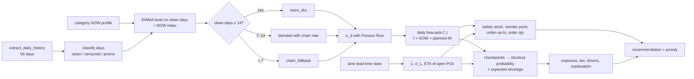

# 05 — Analytics Models

**Related:** `00_DESIGN_SUMMARY.md` §4.2 (parameters), `04_SQL_ANALYTICS.md` (feature SQL), `03_DATABASE_DESIGN.md` §6 (output tables), `10_TEST_AND_QA_PLAN.md` (tests)

This document is the **binding specification** for every calculation in StockSense: demand forecasting with censored sales, lead-time estimation, stockout probability, safety stock, reorder point, order quantity, financial exposure, risk tiers, explanations, recommendations, scenarios, and backtesting. All formulas are implemented as pure functions in `backend/src/stocksense/analytics/`.

Design goals, in order: **correct**, **explainable in an interview**, **reproducible**, **testable with hand-computed examples**.

---

## 1. Notation and time conventions

| Symbol | Meaning | Units |
|--------|---------|-------|
| `T` | As-of date (end of day). Current run: 2026-09-30 | date |
| `t = 1, 2, …` | Future day index; day `t` is date `T + t` | day |
| `d` | A historical date `≤ T`; age `a_d = T − d` | |
| `y_d` | Observed units sold on date `d` | units |
| `f_t` | Forecast demand for future day `t` | units |
| `ℓ` | Deseasonalized demand level | units/day |
| `σ_d` | Standard deviation of daily demand (deseasonalized, after floor) | units/day |
| `D̄` | Average daily demand used for days of cover = `Σ_{t=1}^{28} f_t / 28` | units/day |
| `OH` | On-hand units at end of `T` | units |
| `Q_j`, `ETA_j` | Open quantity and expected arrival date of open PO line `j` | units, date |
| `OO` | On order = `Σ_j Q_j` | units |
| `IP` | Inventory position = `OH + OO` | units |
| `L̄`, `σ_L` | Mean and std of lane lead time (order → first receipt) | days |
| `R` | Review period = 7 | days |
| `α` | Cycle service level (default 0.95) | probability |
| `z_α` | Standard Normal quantile of `α` (0.95 → 1.644854) | |
| `w` | Window length: days of demand that must be covered | days |
| `s` | Standard deviation of the window length | days |

**Timing convention (binding, matches the generator):** receipts arrive at the **start** of a day and are sellable that day; adjustments post at the end of a day. An order placed on day `T+1` with lead time `L` arrives at the start of day `T+1+L`; the demand it must be protected against is days `T+1 … T+L`, i.e. **`L` days**. A PO arriving at date `E` is preceded by **`w = (E − T) − 1` days** of demand.

**Leakage rule:** every quantity computed for as-of date `T` uses only data dated `≤ T`, plus *plans* known at `T` (promotion calendar, PO promised dates).

---

## 2. Pipeline overview



---

## 3. Demand forecasting

### 3.1 Objectives and horizons

Estimate expected daily demand (not sales) for each store-SKU position for the next 42 days, plus its uncertainty.

| Horizon | Operational use |
|---------|-----------------|
| **7 days** | This week's floor actions: expedite, transfer, rebalance displays; matches the weekly review cycle |
| **14 days** | Typical lead time (~10 days) plus buffer: the window in which a reorder decision made today matters |
| **28 days** | Planning: capital commitment, supplier conversations, promotion readiness |
| 42 days (stored only) | Internal: lets lead time + review period + scenario lead-time increases (up to +14 days) be evaluated without extrapolation |

### 3.2 Input data (from `sql/pipeline/extract_daily_history.sql`)

For each position and each date `d ∈ [T−55, T]` (56 days): `y_d`, `availability_status_d`, `is_promo_day_d`, `iso_day_of_week_d`, `category_id`.

### 3.3 Day classification (censoring treatment)

| Class | Rule | Treatment |
|-------|------|-----------|
| **Clean** | `availability_status = in_stock` AND NOT promo | Used for level, variance, pattern, trend |
| **Censored** | `availability_status ∈ {sold_out, out_all_day}` | **Excluded** (treated as missing, never as zero demand) |
| **Promo (uncensored)** | `in_stock` AND promo | Excluded from level (planned lift is applied explicitly to future promo days) |

Why exclusion is defensible:

- On an `out_all_day` day, observed sales are 0 regardless of demand — the observation carries no information about demand.
- On a `sold_out` day, observed sales are a **lower bound** on demand. Using them as-is biases the estimate downward; imputing them requires a model of intra-day demand timing we don't have.
- Excluding both and estimating from clean days assumes demand on censored days resembles demand on clean days (after day-of-week adjustment). This is the standard "missing at random given covariates" assumption and is documented as a limitation (§16). It slightly **under**-estimates demand if stockouts tend to happen precisely on high-demand days (they do), so the estimate is conservative in the direction of *under*-forecasting less than the naive method.
- Observable in real life: availability status is derived from on-hand balances and sales, both of which retailers record. Latent demand is never used.

### 3.4 Day-of-week index

From `sql/pipeline/extract_category_dow_profile.sql` (logic identical to 04 §3.7), as of `T`:

```
idx_c(k) = mean units per clean position-day in category c on ISO weekday k
           ÷ mean over the 7 weekdays of those means
```

Properties: `Σ_k idx_c(k) / 7 = 1`. If any weekday for a category has fewer than 30 observations, the whole category uses a flat profile (`idx = 1`). Category-level pooling gives stable estimates even for slow SKUs.

### 3.5 Level estimation (censoring-aware EWMA)

For position `(s, p)` in category `c`, with clean-day set `C` (dates):

```
z_d = y_d / idx_c(dow(d))                    deseasonalized clean-day demand
w_d = 0.5 ^ (a_d / h)                        h = half_life_days = 14
ℓ_ss = Σ_{d∈C} w_d · z_d / Σ_{d∈C} w_d       store-SKU level
σ²_ss = Σ_{d∈C} w_d · (z_d − ℓ_ss)² / Σ_{d∈C} w_d    weighted (population) variance
n = |C|                                       clean days
```

A 14-day half-life means a day two weeks ago counts half as much as yesterday; it adapts to trend changes within ~3–4 weeks while smoothing daily noise.

### 3.6 Fallback hierarchy for sparse clean data

Chain rate (from `extract_product_chain_rate.sql` and `extract_store_scale.sql`, as of `T`):

```
ℓ_chain(s, p) = [mean of z over all clean position-days of product p, all stores, last 56 days]
                × store_scale(s, c)
store_scale(s, c) = mean clean units per position-day at store s in category c
                    ÷ mean across all stores in category c
```

| Condition | `method` | Level `ℓ` | Observed std `σ_obs` |
|-----------|----------|-----------|----------------------|
| `n ≥ 14` (`min_clean_days_full`) | `store_sku` | `ℓ_ss` | `σ_ss` |
| `7 ≤ n < 14` | `blended` | `λ·ℓ_ss + (1−λ)·ℓ_chain`, with `λ = n / 14` | `σ_ss` |
| `n < 7` and product has ≥ 7 chain clean days in 56 | `chain_fallback` | `ℓ_chain` | `ℓ` (assumes CV = 1, deliberately wide) |
| `n < 7` and chain clean days < 7 in 56, but ≥ 7 over full history ≤ `T` | `chain_fallback` | chain rate over full history × store scale | `ℓ` |
| none of the above | `insufficient_data` | `0` | `0` (tier forced to `moderate`, action `monitor`; §8.1) |

### 3.7 Variance floor

```
σ_d = max(σ_obs, √ℓ)
```

Retail unit demand is a count; its variance is at least approximately its mean (Poisson). The floor prevents unrealistically confident forecasts from short, smooth histories. If `ℓ = 0`, `σ_d = 0`.

### 3.8 Daily forecasts

For `t = 1 … 42`:

```
f_t = ℓ × idx_c(dow(T + t)) × m_t
m_t = planned_lift of the promotion covering (product, store's region, T + t), else 1.00
```

Planned promotions come from `extract_planned_promotions.sql`. Realized lift in the simulation differs from planned lift (06 §5.4), so forecast error on promo days is realistic.

Horizon totals: `F_H = Σ_{t=1}^{H} f_t` for `H ∈ {7, 14, 28}`. Horizon std: `σ_d·√H` (independent days). Beyond day 42 (only in scenarios), `f_t = mean(f_36 … f_42)` (one full week, so the weekday mix is neutral).

### 3.9 Demand pattern classification (Syntetos–Boylan)

On clean days (raw `y`, not deseasonalized), with `k` = number of clean days with `y > 0`:

```
ADI = n / k                                   (NULL if k = 0)
CV² = (stddev_samp(y | y>0) / mean(y | y>0))² (0 if k < 2)
```

| Pattern | Rule |
|---------|------|
| `no_demand` | `k = 0` |
| `smooth` | `ADI ≤ 1.32` and `CV² < 0.49` |
| `erratic` | `ADI ≤ 1.32` and `CV² ≥ 0.49` |
| `intermittent` | `ADI > 1.32` and `CV² < 0.49` |
| `lumpy` | `ADI > 1.32` and `CV² ≥ 0.49` |

If `n < 7`, the pattern is computed on the product's chain-wide clean days instead. The pattern is descriptive (shown in UI, used as a backtest segment and as an explanation of uncertainty); it does **not** switch the estimator. Rationale: the EWMA mean is an unbiased estimator of the daily demand **rate** for intermittent series, which is what inventory risk needs; Croston-type methods estimate the same rate with known bias corrections and add explanation burden.

### 3.10 Demand trend ratio

```
r = mean(z_d : d ∈ C, a_d ≤ 13) / mean(z_d : d ∈ C, 14 ≤ a_d ≤ 55)
```

Requires ≥ 4 clean days in each part, else NULL. Used only for the `demand_acceleration` driver (r ≥ 1.25). Not used in the forecast itself (the EWMA already adapts).

### 3.11 Forecast outputs

Written to `analytics.demand_forecasts` (all runs) and `analytics.demand_forecast_daily` (current run only). Fields defined in 03 §6.2–6.3. `model_version` and `generated` timestamp come from the run row. `forecast_evaluations` hold backtest metadata (§3.12).

### 3.12 Validation: rolling-origin backtest

**Never random splits.** Time-series evaluation with rolling origins:

```
origins o_j = T − 28 − 7·j,  j = 0 … 7   (8 weekly origins: T−77 … T−28)
for small datasets: use as many origins as satisfy o − 55 ≥ history_start
targets: days o+1 … o+28 for each origin
```

At each origin, the **entire forecasting function** is re-run using only data `≤ o` (including the DOW profile, store scale, and chain rates as of `o`). Planned promotions in `(o, o+28]` are used (plans are known in advance).

**Models compared:**

| `model_name` | Definition |
|--------------|-----------|
| `stocksense_v1` | §3.3–3.8 |
| `naive_28d_mean` | Mean of **all** observed sales `y` over `[o−27, o]` (stockout zeros and promo days included), flat for all horizons — what a static report implies |
| `seasonal_naive_7d` | Repeat the last observed week: `f_h = y_{o − 7 + ((h−1) mod 7) + 1}` |

**Evaluation bases:**

| `evaluation_basis` | Included target days | Actual value | Availability |
|--------------------|----------------------|--------------|--------------|
| `observed_in_stock` | Days with `availability_status = in_stock` | `y` (observed sales) | Realistic — what a retailer could compute |
| `simulated_latent` | All days | `latent_units` from `sim_truth` | **Simulation only**; shown with the label "Simulation-only check: compares forecasts with the simulator's hidden true demand, which a real retailer cannot observe." |

Excluding censored days from the observed basis is necessary because their actual demand is unknown; this introduces selection (in-stock days skew toward lower-demand periods), which is why the latent basis is reported alongside it.

**Metrics** (computed per model × basis × segment, over all included (position, target day) pairs):

```
MAE  = Σ|f − a| / N
WAPE = Σ|f − a| / Σa                 (NULL if Σa = 0)
Bias = (Σf − Σa) / Σa                (NULL if Σa = 0; positive = over-forecast)
```

MAPE is **not** used (undefined on zero-demand days, which are common). WAPE handles zeros because it aggregates before dividing.

**Segments:** `overall/all`; `horizon_bucket` ∈ {`1-7`, `8-14`, `15-28`}; `velocity_class` ∈ {`A`,`B`,`C`} (ABC by trailing 56-day revenue as of each origin); `demand_pattern` (pattern as of each origin).

**Reporting rule:** The UI and README report whatever the backtest produces. No accuracy claim is made in documentation before the backtest has run. If `stocksense_v1` does not beat a baseline on some segment, that is shown, not hidden.

### 3.13 Forecasting limitations (shown on Methodology page)

- No annual seasonality or explicit trend: in an October forecast, Lawn & Garden will likely be over-forecast as the season ends.
- Censored days assumed similar to clean days after weekday adjustment.
- Day-of-week profile is category-level, not SKU-level.
- Holiday effects are not modeled in the forecast (no major home-improvement holidays fall in the default forecast window).
- Cross-SKU substitution and cannibalization are ignored.

---

## 4. Lead-time estimation

### 4.1 Lane statistics

From `sql/pipeline/extract_lane_lead_times.sql` as of `T` (04 §4.2): for POs on lane `(supplier, store)` whose first receipt is in `(T−180, T]`:

- `lead_time = first_receipt_date − order_date`
- `delay = first_receipt_date − promised_delivery_date` (promised date = order date + contract lead time, so `lead_time = contract + delay`)
- `n_received`, mean and sample std of each, mean delay among late POs, and the 90-day on-time rate (POs due in `[T−89, T]`; unreceived = late).

### 4.2 Fallback selection (`leadtime.select_lane_estimate`)

| Condition | `lead_time_source` | `L̄` | `σ_L` | delay mean / std |
|-----------|--------------------|-----|-------|------------------|
| lane `n_received ≥ 8` | `lane` | lane mean lead time | `max(0.5, lane std)` | lane values; std floored at 0.5 |
| else supplier pooled `n ≥ 8` | `supplier` | lane contract + supplier mean delay | `max(0.5, supplier std delay)` | supplier values |
| else | `contract` | contract lead time | `0.25 × contract` | 0 / `0.25 × contract` |

`mean_delay_when_late` defaults to 3 days when no late POs exist. The 0.5-day floor prevents degenerate zero-uncertainty lead times. Lane on-time rate is always the lane's own (NULL if no POs due in window).

### 4.3 Expected arrival of open POs (`leadtime.expected_arrival`)

For each open PO line (`extract_open_po_lines.sql`, open quantity `Q > 0` as of `T`) with promised date `P`:

```
if P > T:   ETA = P + max(0, round_half_up(mean_delay_days))       not overdue
            σ_arr = std_delay_days
else:       remaining = max(1, round_half_up(mean_delay_when_late − (T − P)))
            ETA = T + remaining                                     overdue = true
            σ_arr = std_delay_days
w = (ETA − T) − 1     (days of demand before the receipt; ≥ 0)
```

Rationale: suppliers that are usually late are expected to stay late; a PO already past its promised date is assumed to arrive after the supplier's typical lateness, but no sooner than tomorrow. Early arrivals are not assumed (conservative). Open POs with the same ETA are combined into one checkpoint (supply summed; `purchase_order_id` = the lowest id).

### 4.4 Lead-time limitations

- Right-censoring: very late POs that have not arrived by `T` are excluded from lead-time means (biases `L̄` downward slightly); they are, however, counted as late in the on-time rate.
- Lead time is assumed independent of order size and of demand.

---

## 5. Inventory risk engine

### 5.1 Inventory quantities

| Quantity | Definition | Used for |
|----------|-----------|----------|
| On hand `OH` | `closing_on_hand` at `T` | Physical stock; days of cover; supply at checkpoints |
| On order `OO` | Σ open PO quantity as of `T` | Inventory position |
| Inventory position `IP` | `OH + OO` (no backorders or commitments are modeled: cash-and-carry retail, assumption A3) | **Reorder decision only** |
| Scheduled supply at a checkpoint | `OH + Σ Q_j` for POs arriving strictly before that checkpoint | **Stockout probability only** |

**No double counting:** each open PO is counted once in `IP` and, for stockout probability, only at its own arrival time. Pending inventory is never added to on-hand for coverage calculations.

### 5.2 Demand over an uncertain window (`distributions.window_demand`)

Given daily forecasts `f`, a window of mean length `w` days with std `s` days, and daily std `σ_d`:

```
F(w) = Σ_{i=1}^{⌊w⌋} f_i + (w − ⌊w⌋)·f_{⌊w⌋+1}       cumulative forecast (fractional days interpolated)
μ    = F(w)
D̄_w  = μ / w                                         (0 if w = 0)
σ²   = w · σ_d² + D̄_w² · s²
```

This is the standard lead-time demand approximation, assuming (A5) daily demands are independent with common variance and independent of the window length. With a constant daily mean it reduces to the textbook formula:

```
E[LTD]   = D̄ × L̄
Var[LTD] = L̄ × σ_d² + D̄² × σ_L²
```

Using `F(w)` instead of `D̄·w` lets day-of-week effects and planned promotions inside the window count.

### 5.3 Distribution family (`distributions.select_family`)

| Condition | Family | Parameters |
|-----------|--------|------------|
| `μ ≤ 0` | `degenerate` at 0 | — |
| `σ ≤ 1e−9` (and `μ > 0`) | `degenerate` at `μ` | — |
| `μ ≥ 20` (`normal_min_mean_units`) | `normal` | `(μ, σ)` |
| `μ < 20` and `σ² > μ` | `negative_binomial` | `n = μ²/(σ² − μ)`, `p = μ/σ²` (SciPy `nbinom(n, p)` has mean `μ` and variance `σ²`) |
| `μ < 20` and `σ² ≤ μ` | `poisson` | `μ` (slightly overstates variance — conservative) |

Rationale: for fast movers the Normal approximation is accurate and easy to explain ("mean plus z standard deviations"). For slow movers (e.g., 3 units expected over the lead time), demand is a small count; a Normal distribution would assign probability to negative and fractional demand and misstate tail probabilities substantially (worked example 3 shows 52% vs 67%).

Three functions are defined for every family, for integer supply `S ≥ 0`:

| Function | Normal | Count families | Degenerate at `m` |
|----------|--------|----------------|-------------------|
| `prob_exceeds(S) = P(D > S)` | `1 − Φ((S − μ)/σ)` | `sf(S)` | `1 if m > S else 0` |
| `quantile(α)` | `μ + z_α σ` | `ppf(α)` (smallest k with CDF ≥ α) | `m` |
| `expected_shortage(S) = E[(D − S)⁺]` | `σ·[φ(z) − z(1 − Φ(z))]`, `z = (S−μ)/σ` | `μ − S + Σ_{x=0}^{S−1} (S−x)·pmf(x)` | `max(0, m − S)` |

Implementation notes: vectorize over positions; for count families, if `S > ppf(1 − 1e−9)` return `E = 0` and `P = 0` directly; clamp probabilities to `[0, 1]`.

### 5.4 Protection window

```
w_end = L̄     (with s = σ_L)
```

**Interpretation:** the time until an order placed now (tomorrow morning) would arrive. A shortage occurring before `w_end` cannot be prevented by a new order — only by expediting existing POs or moving stock. A shortage after `w_end` can be prevented by ordering now, which is the job of the reorder point (§6). This separation keeps "risk" and "reorder need" distinct and explainable.

### 5.5 Checkpoints and stockout probability (`risk.score_positions`)

A stockout before replenishment happens if, at some moment before supply arrives, cumulative demand exceeds cumulative supply. StockSense checks supply against demand at the moments when it is most likely to fail: **just before each scheduled delivery inside the protection window, and at the end of the window.**

```
Receipt checkpoints: for each distinct ETA_k with w_k < w_end (sorted ascending):
    window w = w_k,  s = σ_arr
    supply S_k = OH + Σ_{j: ETA_j < ETA_k} Q_j
Window-end checkpoint:
    window w = w_end, s = σ_L
    supply S_end = OH + Σ_{j: w_j < w_end} Q_j
For every checkpoint: (μ, σ) from §5.2, family from §5.3,
    P_k = prob_exceeds(S_k),  E_k = expected_shortage(S_k)
Stockout probability   P = max_k P_k
Binding checkpoint     = argmax_k P_k   (ties → larger E_k, then earlier)
Expected shortage      E = E_binding
```

**Normal-case formula statement (for the interview):**

```
mean  μ = expected demand from tomorrow until the checkpoint
sd    σ = √( w·σ_d² + D̄_w²·s² )
supply S = on hand + deliveries arriving before the checkpoint
P(stockout) = 1 − Φ( (S − μ) / σ )
```

**Approximation note:** The true probability that a shortage occurs at *any* checkpoint is the probability of a union of correlated events; the maximum of the individual probabilities is a **lower bound** on it and is usually close when one checkpoint dominates. It is chosen because it is explainable ("the riskiest moment") and does not require a joint distribution. Documented in §16.

**Not the same as reorder-point breach:** `below_reorder_point` compares *inventory position* (including all open POs, whenever they arrive) to the lead-time demand quantile. `stockout_probability` compares *scheduled supply* to demand *before* replenishment. A position can be below its reorder point with low stockout probability (time to reorder, no imminent danger) or above it with high stockout probability (plenty on order, but arriving too late).

**Boundary cases:**

| Case | Result |
|------|--------|
| `μ = 0` (no expected demand) | `P = 0`, `E = 0` |
| `w = 0` (PO arrives tomorrow) | receipt checkpoint has `μ = 0` → `P = 0` |
| `OH = 0` and `μ > 0` | `P = P(D > 0)`; Normal: `Φ(μ/σ)`; count: `1 − pmf(0)` |
| `σ = 0`, `μ > 0` | `P ∈ {0, 1}` by comparison |
| Very large `S` | `P → 0`, `E → 0` |
| All open POs arrive after `w_end` | only the window-end checkpoint, supply = `OH` |

### 5.6 Expected shortage

`E = E[(D − S)⁺]` at the binding checkpoint is the expected number of units demanded but not available before replenishment. It already incorporates probability (it is an expectation over all outcomes), so financial exposure must **not** multiply it by `P` again.

### 5.7 Days of cover

```
D̄ = F_28 / 28
days_of_cover = min(365, OH / D̄)     (NULL if D̄ = 0; 0 if OH = 0)
```

Rounded to 1 decimal. "On-hand only" — it ignores incoming POs by definition. Displayed beside "Next replenishment".

### 5.8 Inventory projection (`risk.project_inventory`)

Expected-value projection for the chart and the projected stockout date, for `t = 1 … 42`:

```
R_t     = Σ Q_j with ETA_j = T + t        (expected receipts, all open POs)
avail_t = on_hand_{t−1} + R_t             (on_hand_0 = OH)
on_hand_t = max(0, avail_t − f_t)         (lost sales: no negative inventory)
projected_stockout_day = first t with f_t > 0 and avail_t ≤ f_t   (NULL if none)
```

Uncertainty band (approximate, ignores receipt-timing uncertainty and lost-sales dynamics; labeled "approximate 80% band"):

```
low_t  = max(0, OH + Σ_{τ≤t} R_τ − (F(t) + 1.2816·σ_d·√t))      P10 inventory (high demand)
high_t = max(0, OH + Σ_{τ≤t} R_τ − (F(t) − 1.2816·σ_d·√t))      P90 inventory (low demand)
```

---

## 6. Replenishment policy: safety stock, reorder point, order-up-to, order quantity

StockSense models a **periodic-review policy with a reorder trigger**: lanes are reviewed weekly (`R = 7`), and StockSense also evaluates every position on the as-of date.

### 6.1 Lead-time demand, safety stock, reorder point (`policy.compute_policy`)

```
(μ_L, σ_L_D) = window_demand(f, w = L̄, s = σ_L, σ_d)
q_L          = quantile_α(LTD)                       (family from §5.3)
safety_stock = max(0, q_L − μ_L) × (1 + b)           b = buffer rate (0 in baseline)
reorder_point = ceil(μ_L + safety_stock)
```

Normal case: `safety_stock = z_α · σ_L_D`, so `reorder_point = ⌈E[LTD] + z_α·σ_LTD⌉` — exactly the textbook definition `Reorder Point = Expected Lead-Time Demand + Safety Stock`.

**Service level definition:** `α` is the **cycle service level**: the probability that demand during a replenishment lead time does not exceed the reorder point (i.e., no stockout in a cycle). It is **not** a fill rate (fraction of demand served). Default 0.95, configurable 0.80–0.995.

**How service level affects safety stock:** `z_α` grows non-linearly: 90% → 1.282, 95% → 1.645, 98% → 2.054, 99% → 2.326, 99.5% → 2.576. Going from 95% to 99% raises Normal-case safety stock by 41%, while expected shortage falls by much less in absolute units. This diminishing return is the core service-level tradeoff (§14).

### 6.2 Order-up-to level (target stock position)

```
(μ_LR, σ_LR) = window_demand(f, w = L̄ + R, s = σ_L, σ_d)
q_LR         = quantile_α(D_{L+R})
order_up_to  = max(reorder_point, ceil(μ_LR + max(0, q_LR − μ_LR) × (1 + b)))
```

The order-up-to level covers lead time **plus** one review period, because the next chance to order is a week away.

### 6.3 Reorder trigger and quantity (`policy.order_quantity`)

```
below_reorder_point = (IP ≤ reorder_point) AND (order_up_to > IP)
if below_reorder_point:
    raw   = order_up_to − IP
    qty   = max(min_order_qty, ceil(raw / case_pack_qty) × case_pack_qty)
    cost  = qty × unit_cost
else: qty = NULL
```

The second condition prevents a meaningless "reorder 0" when a position has no demand (`reorder_point = order_up_to = IP = 0`). MOQ is always a multiple of the case pack (DB CHECK), so `qty` is always a valid orderable quantity.

---

## 7. Financial exposure (`exposure.compute_exposure`)

```
expected_shortage_units  E              (§5.6)
lost_sale_rate           λ_c            category assumption (00 §4.2)
expected_lost_units    = E × λ_c
revenue_at_risk_usd    = expected_lost_units × unit_price
margin_at_risk_usd     = expected_lost_units × (unit_price − unit_cost)
```

Values are computed at full precision and rounded to cents only when stored.

| Assumption | Statement | Direction of uncertainty |
|-----------|-----------|--------------------------|
| Demand shortfall | Expected shortage `E` before the next replenishment, from the demand distribution | Depends on forecast bias; censoring treatment reduces downward bias |
| Lost-sale rate | Only a fraction `λ_c` of unmet demand is lost; the remainder substitutes to another SKU or delays the purchase until restock | Rates are planning assumptions, not measured; configurable |
| Selling price | Regular `unit_price` (promotional discounts ignored) | Overstates revenue during promotions |
| Margin | `unit_price − unit_cost` (no freight, shrink, or labor) | Overstates contribution slightly |
| Horizon | Until the next replenishment (protection window or binding checkpoint) — not annual | Short horizon by design; sums across positions with different windows |
| Demand uncertainty | Expectation over the full demand distribution; no high/low range in MVP | A P90 range is a possible P1 enhancement |

**Labels:** always "Est. gross margin at risk" / "Model estimate". Never "lost revenue".

---

## 8. Risk tiers, drivers, explanations

### 8.1 Tier assignment (`risk.assign_tier`)

Let `w_next = w_1` (first open PO's demand window) if any open PO, else `w_end`, and `μ_next = F(w_next)`.

```
if method == insufficient_data:                       tier = moderate
elif OH == 0 and μ_next ≥ 1:                          tier = critical   (out of stock now)
elif P ≥ 0.50:                                        tier = critical
elif P ≥ 0.25:                                        tier = high
elif P ≥ 0.10:
    tier = high if margin_at_risk_usd ≥ 250.00 else moderate      (financial escalation)
else:                                                 tier = low
```

| Tier | Meaning for the user |
|------|----------------------|
| Critical | More likely than not to stock out before replenishment, or already out with demand expected |
| High | 1-in-4 or worse chance, or meaningful chance with material margin at stake |
| Moderate | Elevated (≥ 1-in-10) chance |
| Low | Within normal operating risk |

No composite weighted score is used. Thresholds and the escalation amount are configuration values stored with each run.

### 8.2 Risk drivers (`explanations.detect_drivers`)

| Driver | Rule |
|--------|------|
| `currently_out_of_stock` | `OH = 0` and `D̄ > 0` |
| `coverage_gap` | `days_of_cover < w_next` |
| `no_inbound_supply` | no open PO and `below_reorder_point` |
| `overdue_po` | any open PO overdue (§4.3) |
| `supplier_unreliable` | lane `on_time_rate < 0.80` (not NULL) |
| `lead_time_variability` | `σ_L / L̄ ≥ 0.30` |
| `demand_acceleration` | trend ratio `r ≥ 1.25` |
| `high_demand_variability` | `observed_demand_cv ≥ 0.75` and `ℓ ≥ 1` |
| `recent_stockouts` | `recent_censored_days ≥ 3` (last 28 days) |
| `upcoming_promotion` | any promo day among days `1 … ⌈w_end⌉` |
| `limited_history` | `method ≠ store_sku` |

Drivers are descriptive associations used to explain a risk; they are not causal claims.

### 8.3 Deterministic explanation text (`explanations.build_explanation`)

Assembled from up to four sentences. All numbers use the shared formatting rules (07 §4.6): units as integers with separators, units/day and days with 1 decimal, probabilities as percentages with 1 decimal, dollars as whole dollars. The breakdown panel uses the same rules, so text and panel always match.

**S1 — coverage**
- If `OH = 0` and `D̄ > 0`: "This item is out of stock now while forecast demand is {D̄} units/day."
- Else if `D̄ = 0`: "On-hand inventory is {OH} units and there has been no recent in-stock demand."
- Else: "On-hand inventory of {OH} units covers about {days_of_cover} days of forecast demand ({D̄} units/day)."

**S2 — replenishment**
- Next open PO not overdue: "The next delivery ({Q} units on {po_number}) is expected on {ETA:Mon D}, after {w} days of selling."
- Next open PO overdue: "{po_number} ({Q} units) was due on {P:Mon D} and has not arrived; based on this supplier's history it is now expected on {ETA:Mon D}."
- No open PO: "No replenishment is on order; a new order from {supplier_name} typically arrives in {L̄} days (±{σ_L})."

**S3 — up to two driver phrases**, in this priority order, skipping drivers already expressed by S1/S2:

| Driver | Phrase |
|--------|--------|
| `recent_stockouts` | "It was out of stock on {n} of the last 28 days; those days were excluded from the demand estimate." |
| `demand_acceleration` | "Recent demand is running {round((r−1)·100)}% above its prior six-week rate." |
| `supplier_unreliable` | "This supplier delivered {round(on_time·100)}% of orders to this store on time over the last 90 days." |
| `lead_time_variability` | "Lead times on this lane vary by about ±{σ_L} days." |
| `high_demand_variability` | "Daily demand is highly variable (coefficient of variation {cv:.2f})." |
| `upcoming_promotion` | "A planned promotion ({promotion_name}) starting {date:Mon D} is expected to lift demand by {round((lift−1)·100)}%." |
| `limited_history` | "There are only {n} clean in-stock days of history, so the estimate leans on chain-wide demand for this item." |

**S4 — risk**: "Estimated stockout probability before replenishment: {P}% ({Tier})." followed, if `margin_at_risk_usd ≥ 1`, by " Estimated gross margin at risk: ${margin} (model estimate)."

Low-tier positions use S1, S2, and S4 only.

Hero example output (05 §13.1):

> On-hand inventory of 100 units covers about 8.3 days of forecast demand (12.0 units/day). No replenishment is on order; a new order from Gulfmark Plumbing Supply Co. typically arrives in 10.0 days (±2.0). This supplier delivered 70% of orders to this store on time over the last 90 days. Estimated stockout probability before replenishment: 75.7% (Critical). Estimated gross margin at risk: $149 (model estimate).

### 8.4 Sensitivity panel (P1, `risk.sensitivity`)

Computed on request for the detail page, using the same scoring function with one input changed at a time:

| Counterfactual | Change |
|----------------|--------|
| Perfectly reliable lead times | `σ_L = 0`, `σ_arr = 0` |
| Open POs arrive on promised date | `ETA = max(T+1, P)` for all open POs |
| Demand variability at Poisson floor | `σ_d = √ℓ` |
| No planned promotion | `m_t = 1` |

Displayed as "Stockout probability would be X% instead of Y%". Contributions are not additive and are labeled as one-at-a-time sensitivities.

---

## 9. Recommendation engine (`replenishment.recommend`)

Recommendations are **decision support**. StockSense never creates purchase orders.

### 9.1 Primary action rules (first match wins)

```
1. expedite_po  if has_open_po and (
                   (binding_checkpoint_type == 'receipt' and P ≥ 0.25)
                or (w_1 ≥ w_end and P ≥ 0.25)                       # existing PO arrives too late
                or (next_receipt_overdue and tier ∈ {moderate, high, critical}) )
                related_po = binding receipt PO, else earliest overdue PO, else earliest open PO
2. reorder      if below_reorder_point
3. monitor      if tier ∈ {moderate, high, critical}
                or method ∈ {blended, chain_fallback, insufficient_data} with ℓ > 0 or insufficient_data
4. no_action    otherwise
```

`recommended_order_units` and `recommended_order_cost_usd` are populated **whenever** `below_reorder_point`, even if the primary action is `expedite_po` (both actions are shown).

**Urgency:** `urgent` if tier ∈ {critical, high}, else `standard`; NULL for `no_action`.

### 9.2 Rationale text (deterministic)

| Action / reason | Text |
|-----------------|------|
| expedite, binding receipt | "Shortage is likely before {po_number} arrives on {ETA:Mon D}; request an expedite or a partial early shipment from {supplier_name}." |
| expedite, PO too late | "Open order {po_number} is not expected until {ETA:Mon D}, later than a new order would typically arrive; request an expedite." |
| expedite, overdue | "{po_number} is past its promised date ({P:Mon D}); confirm the delivery date with {supplier_name} or request an expedite." |
| reorder | "Inventory position ({IP}) is at or below the reorder point ({ROP}). Order {qty} units ({qty/pack} cases of {pack}) to reach the target stock position of {order_up_to}." |
| monitor, elevated risk | "Risk is elevated ({P}%) but inventory position is above the reorder point; review again at the next weekly cycle." |
| monitor, limited history | "The demand estimate relies on chain-wide data; verify shelf availability and on-hand accuracy." |
| no_action | "Inventory and inbound supply cover expected demand with acceptable risk." |

### 9.3 Prioritization (`replenishment.rank`)

Positions with `action_type ≠ no_action` receive `priority_rank = 1 … N` by sorting:

1. `risk_tier` descending (critical first)
2. `margin_at_risk_usd` descending
3. `days_until_projected_stockout` ascending (NULL last)
4. action severity descending (`expedite_po` > `reorder` > `monitor`)
5. `store_id`, `product_id` ascending (deterministic tiebreak)

Interview explanation: "Most dangerous first; within the same danger level, biggest dollars first; then whatever runs out soonest."

### 9.4 Feasibility guards

- Reorder quantities always respect MOQ and case pack.
- No reorder when `order_up_to ≤ IP`.
- Expedite only references a real open PO (DB CHECK).
- No action for inactive products (not scored).
- No transfers in MVP (P2).

### 9.5 Supplier review flag (supplier-level)

Computed in `analytics.v_supplier_performance`: `review_flag = (on_time_rate < 0.80 OR lead_time_cv > 0.35) AND at_risk_positions ≥ 1`. Displayed as "Review supplier" on the Supplier page with the disclaimer: "Flags indicate association between supplier delivery performance and at-risk positions; they do not establish that the supplier caused the risk."

### 9.6 Store transfers (P2 — specified, not implemented in MVP)

Donor store `d` for receiver `r` (same product, same region): donor tier `low`, donor excess `X_d = OH_d − max(reorder_point_d, ⌈F_d(14)⌉) > 0`. Transfer quantity `= min(X_d, ⌈E_r⌉)` rounded down to case pack. Transfer lead time assumption 2 days. Choose the donor with the largest excess. Recompute receiver risk with the transfer as a receipt at `T+2`.

---

## 10. Scenario engine (`scenario.evaluate`)

### 10.1 Inputs

| Input | Field | Range | Neutral |
|-------|-------|-------|---------|
| Lead-time change | `lead_time_change_days` | integer −7 … +14 | 0 |
| Demand change | `demand_change_rate` | −0.50 … +1.00 | 0 |
| Service level | `service_level` | 0.80 … 0.995 | run config (0.95) |
| Safety stock buffer | `safety_stock_buffer_rate` | −0.50 … +1.00 | 0 |
| Scope | `store_ids`, `category_ids`, `supplier_ids` (each optional) | valid IDs | all positions |

Out-of-range values → HTTP 422 (validated by Pydantic before any computation).

### 10.2 Transformation (per position in scope)

```
L̄'     = max(1, L̄ + Δ)                     σ_L unchanged
ETA_j' = max(T + 1, ETA_j + Δ)              for every open PO (Δ applies to inbound shipments too)
f'_t   = (1 + k) · f_t                      σ_d' = (1 + k) · σ_d   (constant CV)
α'     = service_level
b      = safety_stock_buffer_rate
```

Then the **same functions** as the pipeline: `risk.score_positions`, `policy.compute_policy`, `policy.order_quantity`, `exposure.compute_exposure`, `risk.assign_tier`.

**Neutrality invariant (tested):** with neutral inputs, every per-position output equals the stored `inventory_risk_snapshots` row within 1e−6.

### 10.3 Outputs

For both `baseline` (neutral) and `scenario`:

| Metric | Definition |
|--------|-----------|
| `positions_in_scope` | count |
| `positions_by_tier` | counts for each tier |
| `at_risk_positions` | critical + high |
| `mean_stockout_probability` | mean of `P` |
| `expected_shortage_units` | Σ `E` |
| `revenue_at_risk_usd`, `margin_at_risk_usd` | Σ |
| `lead_time_demand_units` | Σ `μ_L` |
| `safety_stock_units`, `safety_stock_value_usd` | Σ SS, Σ SS × unit_cost |
| `positions_below_reorder_point` | count |
| `recommended_order_units`, `recommended_order_value_usd` | Σ qty, Σ cost |
| `annual_carrying_cost_usd` | `safety_stock_value_usd × 0.25` (assumption) |
| `annual_expected_shortfall_margin_usd` | Σ `E[(D_{L+R} − order_up_to)⁺] × λ_c × unit_margin × 365/7` — expected margin lost per year if the policy is followed at current demand |
| `avg_lead_time_days` | mean `L̄'` |

Plus: `delta` (scenario − baseline, absolute; and relative where baseline ≠ 0), `tier_transitions` (4×4 counts baseline tier → scenario tier), `top_changes` (20 positions with largest increase in `margin_at_risk_usd`, ties by increase in `P`), `by_category` (baseline vs scenario margin at risk and at-risk count), `warnings`.

**Warnings:** "Lead time was floored at 1 day for N positions"; "Service levels above 99% require disproportionately more safety stock"; "N positions in scope have insufficient demand history".

### 10.4 Interpretation guidance (shown in UI)

- Lead-time and demand changes affect **near-term risk** (existing stock and POs) and **policy** (reorder points, order quantities).
- Service level and buffer affect **policy only**; they do not change near-term risk, because stock already on hand doesn't change. Their effect appears in the tradeoff panel (carrying cost vs expected shortfall).

---

## 11. Edge cases

| # | Case | Expected behavior |
|---|------|-------------------|
| E1 | Zero demand (`ℓ = 0`, store_sku) | `f = 0`, `σ_d = 0`, `P = 0`, `E = 0`, DOC NULL, tier low, ROP = order-up-to = 0, no reorder, action `no_action` |
| E2 | Out of stock all 56 days | `n = 0` → chain fallback; `currently_out_of_stock`; tier critical if `μ_next ≥ 1`; driver `recent_stockouts`, `limited_history` |
| E3 | Very low inventory (`OH = 1`) with fast demand | `P ≈ 1`, critical |
| E4 | PO arrives tomorrow (`w = 0`) | receipt checkpoint `P = 0`; window-end checkpoint includes the PO |
| E5 | PO overdue | ETA re-estimated (§4.3), driver `overdue_po`, expedite if tier ≥ moderate |
| E6 | Multiple open POs | each its own checkpoint (combined if same ETA) |
| E7 | Partial receipt (open remainder) | remainder treated as overdue open quantity |
| E8 | PO beyond protection window | not a checkpoint; counted in IP; may trigger "PO arrives too late" expedite |
| E9 | Missing days in history (defensive) | reindex to full 56-day grid; missing days treated as censored (excluded) and logged as a warning |
| E10 | Intermittent demand | EWMA rate; NB/Poisson for windows with `μ < 20` |
| E11 | Window beyond 42 forecast days (scenario) | weekly-mean extension (§3.8) |
| E12 | Scenario lead time would go ≤ 0 | floored to 1, warning |
| E13 | Scenario inputs out of range or wrong type | 422 with field errors; no computation |
| E14 | Lane with < 8 receipts | supplier/contract fallback; `lead_time_source` recorded |
| E15 | Product with insufficient data everywhere | `insufficient_data`, tier moderate, action monitor |
| E16 | Negative inventory | impossible by DB CHECK; projection floors at 0 |
| E17 | Service level at bounds (0.80, 0.995) | valid; quantiles finite |
| E18 | Promo in forecast window | planned lift applied; driver `upcoming_promotion` |

---

## 12. Backfill runs (risk trend)

`stocksense analytics backfill --weeks 12` executes the full pipeline (forecast → lead time → risk → recommendations; no backtest) for `as_of ∈ {T−84, T−77, …, T−7}` with `run_type = 'backfill'`, then `stocksense analytics run --evaluate` executes the current run at `T`. Every extraction is point-in-time (04 §4), so each backfill run sees exactly what was knowable on its date. Backfill runs do not store `demand_forecast_daily` (storage control). Result: 13 weekly points for the risk trend chart and a 7-day-ago comparison for KPI deltas.

---

## 13. Worked numerical examples

The inputs below are **illustrative** (chosen to be easy to follow by hand). They are not claims about the generated dataset: product 187 in a generated database will have whatever attributes the generator assigns. Hand calculations use 4–5 significant digits and were cross-checked numerically during design. Automated tests (`tests/unit/test_golden_cases.py`, fixtures in `tests/fixtures/golden_cases.json`) compute with SciPy and assert agreement within **±0.002 for probabilities, ±0.05 units for unit quantities, ±$0.05 for money**, and exact equality for integers (ROP, order-up-to, order quantity).

### 13.1 Example 1 — Hero position, no open PO (Tampa, PEX fitting kit)

**Inputs:** store S03 Tampa, product 187 *Aquaveld 1/2 in. PEX-B Crimp Fitting Kit (25-Pack)*, Plumbing (`λ = 0.65`), price $24.98, cost $15.49 (unit margin $9.49), case pack 12, MOQ 24. `OH = 100`, no open POs. Flat forecast `f_t = 12.0` for all `t` (flat weekday profile assumed for readability), `σ_d = 5.0`. Lane: `L̄ = 10.0`, `σ_L = 2.0`, on-time rate 0.7037. `α = 0.95`, `z = 1.644854`. `R = 7`.

**Days of cover:** `100 / 12 = 8.3` days.

**Window-end checkpoint** (`w = 10`, `s = 2`, supply 100):
- `μ = 12 × 10 = 120`
- `σ² = 10 × 25 + 12² × 2² = 250 + 576 = 826`, `σ = 28.740`
- `μ ≥ 20` → Normal. `z = (100 − 120)/28.740 = −0.6959`
- `P = 1 − Φ(−0.6959) = Φ(0.6959) = 0.7568`
- `φ(0.6959) = 0.31316`; `E = 28.740 × [0.31316 + 0.6959 × 0.7568] = 28.740 × 0.83977 = 24.14` units

**Exposure:** lost units `24.135 × 0.65 = 15.688`; revenue at risk `15.688 × 24.98 = $391.88`; margin at risk `15.688 × 9.49 = $148.88`.

**Tier:** `P = 0.757 ≥ 0.50` → **Critical**.

**Policy:**
- Safety stock `= 1.644854 × 28.740 = 47.27`; reorder point `= ⌈120 + 47.27⌉ = 168`
- Order-up-to window `w = 17`: `μ = 204`; `σ² = 17 × 25 + 144 × 4 = 1001`, `σ = 31.639`; `⌈204 + 1.644854 × 31.639⌉ = ⌈256.04⌉ = 257`
- `IP = 100 ≤ 168` and `257 > 100` → below reorder point
- Raw `257 − 100 = 157` → `⌈157/12⌉ = 14` cases → **168 units**, cost `168 × 15.49 = $2,602.32`

**Projection:** day 8 ends with 4 units; day 9 available 4 ≤ 12 → projected stockout **2026-10-09** (9 days).

**Drivers:** `coverage_gap` (8.3 < 10), `no_inbound_supply`, `supplier_unreliable` (70% < 80%). **Action:** `reorder`, urgent.

### 13.2 Example 2 — Open PO creates a receipt checkpoint (Atlanta, extension cord)

**Inputs:** S01 Atlanta, product 131 *Voltrane 50 ft. 12/3 Outdoor Extension Cord*, Electrical (`λ = 0.55`), price $39.97, cost $24.10 (margin $15.87), case pack 6, MOQ 12. `OH = 40`. Open PO-104512, 96 units, promised 2026-10-06; lane mean delay 0.92 → `round = 1` → `ETA = 2026-10-07`, `w = (7) − 1 = 6`, `σ_arr = 1.5`. Lane `L̄ = 12`, `σ_L = 3`. Flat `f = 8.0`, `σ_d = 4.0`.

**Checkpoint 1 — receipt** (`w = 6`, `s = 1.5`, supply 40): `μ = 48`; `σ² = 6 × 16 + 64 × 2.25 = 240`, `σ = 15.492`; `z = −0.5164`; `P₁ = 0.6972`; `E₁ = 15.492 × [0.34914 + 0.5164 × 0.6972] = 10.99`.

**Checkpoint 2 — window end** (`w = 12`, `s = 3`, supply 40 + 96 = 136): `μ = 96`; `σ² = 12 × 16 + 64 × 9 = 768`, `σ = 27.713`; `z = 1.4434`; `P₂ = 0.0745`; `E₂ = 0.92`.

**Result:** binding = receipt checkpoint; `P = 0.6972` → **Critical**; `E = 10.99`; lost `6.043`; revenue `$241.52`; margin `$95.90`.

**Interpretation:** the PO is big enough, but it arrives a day after the shelf is expected to empty (days of cover 5.0 vs 6 selling days before arrival).

**Policy:** ROP: `μ_L = 96`, `σ = 27.713` → `⌈96 + 45.58⌉ = 142`. `IP = 136 ≤ 142` → below ROP. Order-up-to: `w = 19`, `μ = 152`, `σ² = 304 + 576 = 880`, `σ = 29.665` → `⌈152 + 48.80⌉ = 201`. Raw 65 → 11 cases of 6 = **66 units**, `$1,590.60`.

**Action:** `expedite_po` (PO-104512), urgent; recommended order 66 units also shown. Projected stockout day 5 (2026-10-05).

### 13.3 Example 3 — Slow mover uses a count distribution (Phoenix, turnbuckle)

**Inputs:** S12 Phoenix, Hardware (`λ = 0.35`), price $12.98, cost $5.84 (margin $7.14). `OH = 2`, no PO. `f = 0.4`/day, `σ_d = 0.9`. `L̄ = 8`, `σ_L = 2`.

- `μ = 3.2`; `σ² = 8 × 0.81 + 0.16 × 4 = 7.12`
- `μ < 20`, `σ² > μ` → Negative Binomial: `p = 3.2/7.12 = 0.44944`, `n = 10.24/3.92 = 2.6122`
- pmf(0) = 0.12379, pmf(1) = 0.17804, pmf(2) = 0.17704 → CDF(2) = 0.47886
- `P(D > 2) = 0.5211` → **Critical** (Normal approximation would give `Φ(0.4497) = 0.6735`)
- `E = 3.2 − 2 + (2 × 0.12379 + 1 × 0.17804) = 1.6256`; lost 0.569; margin at risk `$4.06`
- Reorder point: smallest k with CDF ≥ 0.95: CDF(7) = 0.9275, CDF(8) = 0.9539 → **ROP = 8**, safety stock `8 − 3.2 = 4.8`

**Teaching point:** this position is Critical by probability but carries only $4 of margin, so the lexicographic ranking places it below Critical positions with large exposure.

### 13.4 Example 4 — Censoring-aware forecast vs naive average

Configuration override for readability: `lookback_days = 14`, `min_clean_days_full = 7`, flat weekday profile, no promotions.

| Age | 13 | 12 | 11 | 10 | 9 | 8 | 7 | 6 | 5 | 4 | 3 | 2 | 1 | 0 |
|-----|----|----|----|----|---|---|---|---|---|---|---|---|---|---|
| Sold | 6 | 5 | 7 | 6 | 0 | 0 | 0 | 5 | 6 | 7 | 3 | 0 | 0 | 6 |
| Status | in | in | in | in | out | out | out | in | in | in | sold_out | out | out | in |

- **Naive 14-day mean:** `51 / 14 = 3.64` units/day
- **Clean days:** ages 13, 12, 11, 10, 6, 5, 4, 0 → `n = 8`
- Weights `0.5^(age/14)`: 0.52537, 0.55205, 0.58007, 0.60951, 0.74299, 0.78071, 0.82034, 1.00000 (Σ = 5.61104)
- `Σ w·y = 33.7716` → **`ℓ = 6.019`** units/day (65% higher than naive)
- Weighted variance `= 2.69344 / 5.61104 = 0.4800`, `σ_obs = 0.693`; floor `√6.019 = 2.453` → `σ_d = 2.453`
- `method = store_sku`; `censored_days = 6` (5 out_all_day + 1 sold_out)

A naive model would order roughly 40% less than needed and recreate the stockouts — the "censored demand death spiral" (shown on the Methodology page).

### 13.5 Example 5 — Scenario on the hero position (+4 days lead time, +20% demand)

`L̄' = 14`, `f' = 14.4`, `σ_d' = 6.0`, `α = 0.95`, `b = 0`.

- Window end `w = 14`, `s = 2`: `μ = 201.6`; `σ² = 14 × 36 + 207.36 × 4 = 1333.44`, `σ = 36.516`; `z = −2.7823`; `P = 0.9973`; `E = 101.63`
- Lost `66.06`; margin at risk **$626.90** (baseline $148.88); revenue $1,650.16
- ROP: `⌈201.6 + 60.06⌉ = 262` (baseline 168). Order-up-to `w = 21`: `μ = 302.4`, `σ² = 756 + 829.44 = 1585.44`, `σ = 39.818` → `⌈367.90⌉ = 368`. Order `268 → 23 cases = 276` units, `$4,275.24` (baseline 168 units)
- Days of cover `100 / 14.4 = 6.9`

### 13.6 Example 6 — Raising service level from 95% to 98% (hero position)

`z₀.₉₈ = 2.053749`.

| Metric | 95% | 98% |
|--------|-----|-----|
| Safety stock (units) | 47.27 | 59.03 |
| Reorder point | 168 | 180 |
| Order-up-to | 257 | 269 |
| Recommended order | 168 | 180 |
| Safety stock value at cost | $732.27 | $914.30 |
| Annual carrying cost (25%) | $183.07 | $228.58 |
| Expected shortage per cycle `E[(D₁₇ − S)⁺]` | 0.615 units | 0.232 units |
| Annual expected shortfall margin (`× 0.65 × 9.49 × 365/7`) | $197.66 | $74.58 |

Raising the service level costs about **$46/year** more in carrying cost and avoids about **$123/year** of expected margin loss for this position. For low-margin, slow positions the same change can cost more than it saves — the Scenario Lab shows this tradeoff in aggregate.

---

## 14. Tradeoffs (explained in UI and interview material)

| Lever | Benefit | Cost / risk |
|-------|---------|-------------|
| Higher service level | Fewer stockouts, less margin at risk per cycle | Safety stock grows non-linearly (`z` rises steeply above 95%); more capital and carrying cost; more markdown/obsolescence exposure |
| Larger safety stock buffer | Absorbs forecast error and supplier variability | Same as above, applied uniformly regardless of each SKU's economics |
| Leaner inventory | Frees capital, lower carrying cost | Higher stockout probability, more expedites, more lost margin |
| Supplier reliability improvement | Reduces `σ_L` → lower safety stock *and* lower risk simultaneously | Requires supplier management effort; the only lever that improves both sides |
| Expediting | Cuts near-term risk on specific positions | Freight premiums, supplier goodwill; not scalable |

Key message for the demo: *reducing lead-time variability lowers both risk and inventory, whereas raising service levels buys risk reduction with capital.*

---

## 15. Golden test cases (must exist in `tests/fixtures/golden_cases.json`)

| ID | Case | Expected key outputs |
|----|------|----------------------|
| G1 | Example 1 | `P = 0.7568`, `E = 24.14`, `margin = 148.88`, `ROP = 168`, `order_up_to = 257`, `qty = 168`, tier critical, action reorder |
| G2 | Example 2 | `P = 0.6972` (binding receipt), `P₂ = 0.0745`, `ROP = 142`, `S = 201`, `qty = 66`, action expedite_po |
| G3 | Example 3 | family NB, `P = 0.5211`, `E = 1.6256`, `ROP = 8` |
| G4 | Example 4 | `ℓ = 6.019`, `σ_d = 2.453`, naive 3.643, `censored_days = 6` |
| G5 | Example 5 | `P = 0.9973`, `margin = 626.90`, `ROP = 262`, `qty = 276` |
| G6 | Example 6 | `ROP = 180`, `S = 269`, `qty = 180` |
| G7 | Zero demand | `P = 0`, `E = 0`, DOC NULL, action no_action |
| G8 | `OH = 0`, `D̄ = 5`, no PO, `L̄ = 7` | tier critical, driver `currently_out_of_stock` |
| G9 | PO arriving tomorrow, `OH = 0` | receipt checkpoint `P = 0` |
| G10 | Overdue PO: `P = T − 2`, `mean_delay_when_late = 4` | `ETA = T + 2` |
| G11 | Overdue PO: `P = T − 6`, `mean_delay_when_late = 4` | `ETA = T + 1` (floor) |
| G12 | Neutral scenario on G1 | identical to G1 |

---

## 16. Assumptions and limitations (consolidated)

1. Demand on censored days resembles clean-day demand after weekday adjustment (missing-at-random).
2. Daily demands independent; demand independent of lead time (variance formula).
3. Normal approximation for window demand ≥ 20 units; count distributions below.
4. Max-of-checkpoints probability is a lower bound on the union probability.
5. Lost-sale rates are assumptions, not estimates.
6. No backorders, committed inventory, or customer orders.
7. No distribution centers; direct-to-store lanes.
8. Prices static except promotions; exposure uses regular price.
9. Lead-time estimates are right-censored by unreceived POs.
10. No annual seasonality, trend term, or holiday effects in the forecast.
11. The projection band is approximate.
12. Recommendations do not consider supplier capacity, truck minimums, or shelf capacity.
13. All results describe a simulated network and are not evidence about any real retailer.

### 16.1 Business logic relationships — invariants vs. model-dependent

| Relationship | Strict invariant? | Notes / test approach |
|--------------|-------------------|-----------------------|
| More on-hand (other inputs fixed) → stockout probability does not increase | **Strict** (`prob_exceeds` is non-increasing in `S`) | Property test |
| Higher service level → reorder point does not decrease | **Strict** (quantile monotone in `α`) | Property test |
| Greater `σ_d` or `σ_L` → safety stock does not decrease (Normal family) | **Strict for Normal**; for count families nearly always, but family switching at `μ = 20` can cause small non-monotonicity | Property test restricted to Normal; separate test documents count behavior |
| Higher demand → higher stockout probability | **Model-dependent**: holds for fixed family; family switch at `μ = 20` can produce small reversals | Test on Normal range; check aggregate monotonicity in scenarios |
| Longer lead time → higher stockout probability (no POs) | Strict for Normal and NB/Poisson with fixed family (mean and variance both increase) | Property test on fixed family |
| Projected on-hand never negative | **Strict** | Unit test + DB CHECK |
| Neutral scenario equals baseline | **Strict** | Integration test |
| `reorder_point ≤ order_up_to` | **Strict** (enforced by `max`) | DB CHECK + unit test |
